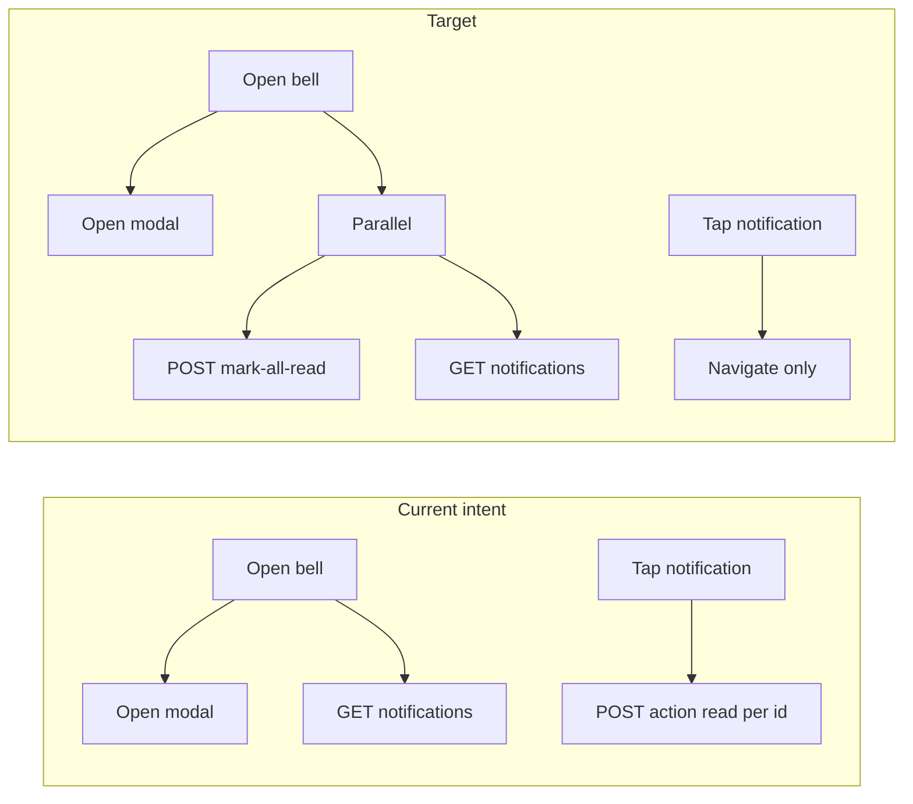

# Bulk mark-all-read for in-app notifications

## Current state (important)

- **Backend service is not wired to HTTP today.** In [`project-ihsan-backend/supabase/functions/engagement-management/index.ts`](project-ihsan-backend/supabase/functions/engagement-management/index.ts), `POST .../notification?action=action` is a **stub**: it returns success with `message` / `notificationId` and **never** calls [`NotificationsService.actionNotification`](project-ihsan-backend/supabase/functions/services/notifications-service.ts). [`actionNotification`](project-ihsan-backend/supabase/functions/services/notifications-service.ts) is also **unused** elsewhere in the backend (grep shows no callers).
- **Client/server mismatch for `userId`:** [`SupabaseEdgeFunctions.actionNotification`](project-ihsan/src/services/SupabaseEdgeFunctions.ts) sends query params `{ action: 'action' }` only, while the edge handler expects `userId` in the **query** for the action branch. So even the stub path is likely fragile or failing validation depending on environment.
- **Delete:** App code only uses `action: 'read'` in [`DashBoardScreen/index.tsx`](project-ihsan/src/views/screens/DashBoardScreen/index.tsx) and [`SocialScreen/index.tsx`](project-ihsan/src/views/screens/SocialScreen/index.tsx); no notification `delete` usage in the app. Repository [`deleteNotification`](project-ihsan-backend/supabase/functions/repositories/notifications-repository.ts) can be removed with the per-id API.

## Recommended API shape (reuse same function URL)

Keep **one** edge URL: `POST /functions/v1/engagement-management/notification` with a **new** query discriminator, consistent with `register` / `unregister`:

- **Query:** `action=mark-all-read` and `userId=<uuid>` (same pattern as GET notifications in the same handler).
- **Body:** `{}` or omit; implement safe JSON parse (`await req.json().catch(() => ({}))`) for this branch so an empty body does not break.
- **Handler:** New `case 'mark-all-read':` in the `switch (action)` inside `handleNotificationRequest`; validate `userId` (reuse the same UUID regex used for GET). Call `notificationsService.markAllNotificationsRead(userId)` (new method).
- **Remove:** the entire `case 'action':` stub (and any references to per-id `notificationId` / `read` / `delete` for this route).

This avoids inventing a second edge function while clearly separating device registration from read semantics.

## Backend implementation

1. **Repository** ([`notifications-repository.ts`](project-ihsan-backend/supabase/functions/repositories/notifications-repository.ts))
   - Add `markAllAsRead(userId: string): Promise<void>` (or return `number` of rows updated if useful for logging) using Supabase: `update({ is_read: true }).eq('user_id', userId).eq('is_read', false)` (idempotent).
   - Remove `markAsRead` and `deleteNotification` from `INotificationsRepository` and the class.

2. **Service** ([`notifications-service.ts`](project-ihsan-backend/supabase/functions/services/notifications-service.ts))
   - Add `markAllNotificationsRead(userId: string)` that calls the repository then returns fresh counts via existing `getNotificationCounts` (so the HTTP response can include `summary` the app expects).
   - Remove `actionNotification` from `INotificationsService` and the class implementation.

3. **Controller** ([`engagement-management/index.ts`](project-ihsan-backend/supabase/functions/engagement-management/index.ts))
   - Add `mark-all-read` case; return `createSuccessResponse` payload aligned with what the client needs (see below).
   - Update the `default` error message list of valid actions to include `mark-all-read` and exclude the removed `action` case.

4. **Response contract for the app**  
   Today RTK [`onQueryStarted`](project-ihsan/src/store/api/supabaseEdgeFunctionsApi.ts) expects `data.summary` after a mutation. Define a small response shape, e.g. `{ summary: { total, unread }, message: string }` with `unread === 0` after success (and `total` from counts). Optionally include `updatedCount` for debugging only.

5. **Docs / OpenAPI** (only if you treat spec as source of truth): update [`openapi.yaml`](project-ihsan-backend/openapi.yaml) / [`openapi_updated.yaml`](project-ihsan-backend/openapi_updated.yaml) and [`IN_APP_NOTIFICATIONS.md`](project-ihsan-backend/documentations/architecture/IN_APP_NOTIFICATIONS.md) to describe `mark-all-read` and remove per-id action documentation—**skip** unless your team requires spec sync for every change.

## Mobile / RTK implementation

1. **Models** ([`NotificationModels.ts`](project-ihsan/src/models/NotificationModels.ts))  
   - Replace `ActionNotificationsRequest` / `ActionNotificationsResponse` (or add parallel types and delete the old ones) with something like `MarkAllNotificationsReadRequest { userId: string }` and `MarkAllNotificationsReadResponse { summary: NotificationCounts; message?: string }`.

2. **Edge client** ([`SupabaseEdgeFunctions.ts`](project-ihsan/src/services/SupabaseEdgeFunctions.ts))  
   - Replace `actionNotification` with `markAllNotificationsRead`: `POST` to `ACTION_NOTIFICATIONS` URL with query params `{ action: 'mark-all-read', userId: request.userId || user.id }` and body `{}` or minimal JSON.

3. **RTK Query** ([`supabaseEdgeFunctionsApi.ts`](project-ihsan/src/store/api/supabaseEdgeFunctionsApi.ts))  
   - Replace `actionNotification` mutation with `markAllNotificationsRead`.  
   - Adjust `onQueryStarted`: for mark-all, update `getNotifications` cached draft by setting `isRead: true` on **all** `draft.items` and `draft.summary = data.summary` (instead of single-id logic).  
   - Keep `invalidatesTags` for `Notifications` as today so dashboard badge / lists stay coherent.

4. **Bell open handlers**  
   - [`DashBoardScreen/index.tsx`](project-ihsan/src/views/screens/DashBoardScreen/index.tsx): In `handleOpenNotifications`, after `setShowNotifications(true)` / page reset, start **`refetchNotifications()`** and **`markAllNotificationsRead(...)`** in **parallel** (e.g. `void Promise.all([refetchNotifications(), markAllNotificationsRead(...).unwrap()])` or equivalent without blocking one on the other). Rationale: list data arrives quickly while the bulk update runs; RTK `onQueryStarted` / cache patches from the mutation keep the badge and rows coherent when the mutation resolves—if GET finishes first, a follow-up refetch or mutation cache update still converges to all-read. Handle errors so a failed mark-all does not prevent showing the list.  
   - [`SocialScreen/index.tsx`](project-ihsan/src/views/screens/SocialScreen/index.tsx): Same parallel pattern wherever the bell opens the modal (grep `setShowNotifications(true)`).

5. **Remove per-row read**  
   - Remove `actionNotification` / `useActionNotificationMutation` usage from `handleNotificationPress` in Dashboard and Social containers; keep navigation and analytics as-is.

6. **Hooks export**  
   - Rename exported hook to `useMarkAllNotificationsReadMutation` (or keep a generic name—prefer explicit).

## Testing / verification

- Manually: create unread rows, open bell, confirm DB `is_read` flips for all rows for that user and badge count goes to zero after refetch.
- Regression: device `register` / `unregister` POST branches unchanged.
- No DB migration required (`is_read` already exists on `notifications`).

## Out of scope (unless you ask)

- Push notification badge sync on the OS (FCM); this plan is in-app history + API only.
- AuthZ hardening (e.g. JWT `sub` must equal `userId`): not present elsewhere in this controller for notifications GET; optional follow-up.
