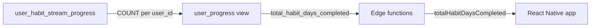

# Habit Days Completed

## Overview

Replace **Habit Streams Completed** with **Habit Days Completed** on the dashboard stat card and accountability partner detail cards. Count every row in `user_habit_stream_progress` for the user (`COUNT(*)` where `user_id` matches). Rename `total_habit_streams_completed` in the `user_progress` view to `total_habit_days_completed`, propagate through all backend service/repository layers and the React Native app, and **remove every** `totalHabitStreams*` / `habitStreamsCompleted` / `total_habit_streams_*` identifier (no aliases or legacy fields). Deploy migration + edge functions to Supabase project `znjkyjbbycnajxepyjfi`.

**Not in scope:** `project-ihsan-admin` (no references). Historical migration files are left unchanged; only a new forward migration updates live schema.

---

## Goal

| Before | After |
|--------|--------|
| Label: "Habit Streams Completed" | Label: "Habit Days Completed" |
| `user_progress.total_habit_streams_completed` (counts `habit_streams`) | `user_progress.total_habit_days_completed` (counts `user_habit_stream_progress` rows) |
| API: `totalHabitStreamsCompleted` | API: `totalHabitDaysCompleted` |

**Count semantics:** `COUNT(*)` from `user_habit_stream_progress` for `user_id`. Each progress log = one habit day. Multiple streams completed on the same calendar day = multiple days.

---

## Current behavior (problem)

[`user_progress`](project-ihsan-backend/supabase/migrations/20260513000000_0026_simplify_habit_stream_status.sql) still counts habit streams via a join that no longer reflects completions:

```sql
COUNT(DISTINCT hs.id) as total_habit_streams_completed
LEFT JOIN public.habit_streams hs ON up.user_id = hs.user_id AND hs.status = 'NOT_STARTED'
```

This does not use progress logs and is incorrect after habit-stream status simplification.

---

## Target data flow



---

## 1. Database migration

**File:** `project-ihsan-backend/supabase/migrations/20260517000000_0029_habit_days_completed_in_user_progress.sql`

1. `DROP VIEW IF EXISTS public.user_progress CASCADE;`
2. Recreate `user_progress` — keep all other columns from migration 0026, but:
   - **Remove** `LEFT JOIN public.habit_streams hs ...` (only used for old metric).
   - **Add** correlated subquery (avoids join fan-out on gem/exercise counts):

```sql
(
  SELECT COUNT(*)
  FROM public.user_habit_stream_progress uhsp
  WHERE uhsp.user_id = up.user_id
) AS total_habit_days_completed
```

3. Update `COMMENT ON VIEW public.user_progress` to describe habit **days** from progress logs.
4. `DROP FUNCTION IF EXISTS public.get_accountability_partner_details(uuid, uuid, text);`
5. Recreate `get_accountability_partner_details` from [`20251214003400_optimized_partner_details_with_timezone.sql`](project-ihsan-backend/supabase/migrations/20251214003400_optimized_partner_details_with_timezone.sql) with **only** these renames (no `total_habit_streams_completed` anywhere):
   - `RETURNS TABLE (... total_habit_days_completed integer, ...)`
   - `partner_data` CTE: `uprog.total_habit_days_completed`
   - `SELECT INTO` / `RETURN QUERY`: `total_habit_days_completed`

**Note:** `accountability_partner_details` view was CASCADE-dropped in 0026 and not recreated; partner UI uses the RPC only.

---

## 2. Backend — full cleanup (services, repositories, models, API spec)

**Rule:** After implementation, this must return **zero** matches in `project-ihsan-backend/supabase/functions` (excluding historical migrations):

```bash
rg -i 'total_habit_streams|totalHabitStreams|habit_streams_completed' project-ihsan-backend/supabase/functions
rg -i 'total_habit_streams|totalHabitStreams|habit_streams_completed' project-ihsan-backend/openapi*.yaml
```

### Files to change

| File | Action |
|------|--------|
| [`dashboard-models.ts`](project-ihsan-backend/supabase/functions/shared/models/dashboard-models.ts) | `UserStats.totalHabitDaysCompleted` — delete `totalHabitStreamsCompleted` |
| [`dashboard-service.ts`](project-ihsan-backend/supabase/functions/services/dashboard-service.ts) | Map `userProgress.total_habit_days_completed`; remove old property name |
| [`user-progress-repository.ts`](project-ihsan-backend/supabase/functions/repositories/user-progress-repository.ts) | Doc comment: `total_habit_days_completed` — habit days from progress table |
| [`accountability-partners-repository.ts`](project-ihsan-backend/supabase/functions/repositories/accountability-partners-repository.ts) | RPC result type: `total_habit_days_completed: number` only |
| [`accountability-partners-service.ts`](project-ihsan-backend/supabase/functions/services/accountability-partners-service.ts) | `PartnerDetails.totalHabitDaysCompleted`; mapping from `details.total_habit_days_completed` |
| [`openapi.yaml`](project-ihsan-backend/openapi.yaml) | Rename schema property, descriptions, examples, `required` arrays |
| [`openapi_updated.yaml`](project-ihsan-backend/openapi_updated.yaml) | Same as above |

**Unchanged (not the stat metric):** `habitStreams` on dashboard payload, `habit-stream-service`, `habit-streams-repository`, habit stream CRUD endpoints — these manage active/unlocked streams, not the completed-days count.

**No dedicated functions** like `getTotalHabitStreamsCompleted()` exist today; cleanup is rename-only across types and mappings.

---

## 3. React Native app — full cleanup

**Rule:** After implementation, zero matches in `project-ihsan/src`:

```bash
rg -i 'totalHabitStreams|habitStreamsCompleted|Habit Streams Completed' project-ihsan/src
```

### Files to change

| File | Action |
|------|--------|
| [`DashboardParams.ts`](project-ihsan/src/models/DashboardParams.ts) | `UserStats.totalHabitDaysCompleted` |
| [`DashboardScreen.view.tsx`](project-ihsan/src/views/screens/DashBoardScreen/DashboardScreen.view.tsx) | `userStats?.totalHabitDaysCompleted`; label `'Habit Days Completed'` |
| [`AccountabilityPartnerModels.ts`](project-ihsan/src/models/AccountabilityPartnerModels.ts) | `totalHabitDaysCompleted` on partner details response type |
| [`PartnerDetailCard.tsx`](project-ihsan/src/views/components/PartnerDetailCard.tsx) | `partnerDetails?.totalHabitDaysCompleted`; labels `Habit Days\nCompleted` (loaded + skeleton states); remove `habitStreamsCompleted` from `Partner` interface if unused |
| [`SocialScreen/types.ts`](project-ihsan/src/views/screens/SocialScreen/types.ts) | Rename `habitStreamsCompleted` → `habitDaysCompleted` |
| [`SocialScreen/index.tsx`](project-ihsan/src/views/screens/SocialScreen/index.tsx) | `habitDaysCompleted: 0` in placeholder partner object |
| [`ResponsiveText.tsx`](project-ihsan/src/views/components/ResponsiveText.tsx) | Comment example: `Habit Days Completed` |

RTK Query / [`SupabaseEdgeFunctions.ts`](project-ihsan/src/services/SupabaseEdgeFunctions.ts): no explicit field names for this stat (typed via models); verify no hardcoded strings after grep.

---

## 4. Deploy to Supabase (`znjkyjbbycnajxepyjfi`)

From `project-ihsan-backend/`:

```bash
cd project-ihsan-backend
supabase link --project-ref znjkyjbbycnajxepyjfi   # if not already linked
supabase db push --project-ref znjkyjbbycnajxepyjfi
supabase functions deploy --project-ref znjkyjbbycnajxepyjfi
```

**Order:** migration → edge functions → app release (breaking JSON rename).

### Verification

- SQL: `SELECT user_id, total_habit_days_completed FROM user_progress` matches `SELECT user_id, COUNT(*) FROM user_habit_stream_progress GROUP BY user_id`.
- Dashboard API: `userStats.totalHabitDaysCompleted` equals progress row count.
- Partner RPC: `total_habit_days_completed` matches same count.
- App: dashboard + partner cards show new label and value.
- Grep cleanup commands above return no hits in functions/app source.

---

## 5. Implementation todos

- [ ] **migration** — Add `0029` migration: `user_progress` + `get_accountability_partner_details` RPC
- [ ] **edge-functions** — Rename all backend types/mappings; update OpenAPI; run grep cleanup
- [ ] **app** — Rename all app types/UI; run grep cleanup
- [ ] **deploy** — `db push` + `functions deploy` to `znjkyjbbycnajxepyjfi`; verify counts

---

## Risks

- **Breaking API change** — requires coordinated backend + app deploy.
- **Old app builds** — will show `0` or undefined until updated (no backward-compat shim per cleanup requirement).
- **Historical migrations** — not edited; live DB updated only via `0029`.
