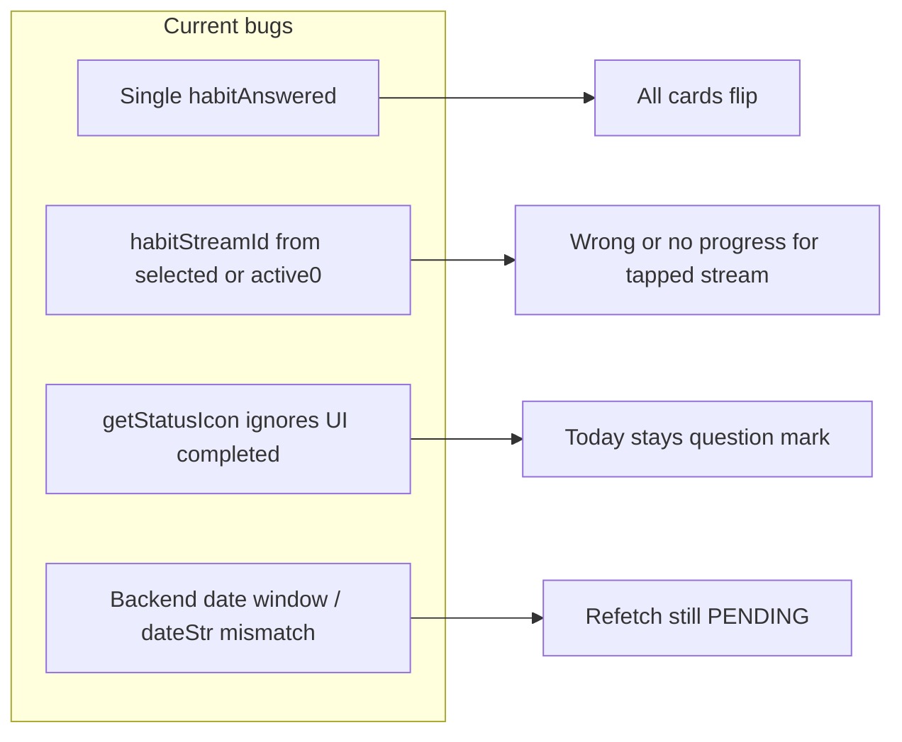

# Habit Stream dashboard card bugfix

## What is going wrong (verified in code)

**1. All active cards flip together**  
Every row item renders [`HabitStreamCard`](project-ihsan/src/views/screens/DashBoardScreen/DashboardScreen.view.tsx) with the same `uiState` and `actions`. [`DashboardUIState.habitAnswered`](project-ihsan/src/views/screens/DashBoardScreen/types.ts) is a single flag. [`handleHabitAnswer`](project-ihsan/src/views/screens/DashBoardScreen/index.tsx) calls `setHabitAnswered('yes')` after a successful log, so **every** card sees `uiState.habitAnswered === 'yes'` and switches to the stats layout.

**2. Wrong stream may be logged**  
Same handler resolves the stream id as:

```628:629:project-ihsan/src/views/screens/DashBoardScreen/index.tsx
          const habitStreamId = uiState.selectedHabitStream?.id || dashboardStats?.habitStreams?.active?.[0]?.id;
```

`selectedHabitStream` is set from the **Available** flow (`onSelectUnlockedStream`), not when the user taps **Mark Completed** on a specific active card. So logging often targets **`active[0]`**, not the card the user pressed. That matches “other cards flip but today stays ?” on the card whose stream was never updated.

**3. “?” does not turn into a checkmark even when the UI considers today completed**  
When `isTodayCompleted` is true, the week strip still renders icons from **`day.status` only** in `getStatusIcon()` ([`DashboardScreen.view.tsx`](project-ihsan/src/views/screens/DashBoardScreen/DashboardScreen.view.tsx) ~271–279). For today, `PENDING` always yields `'?'` and never consults `isTodayCompleted`. So the flip can happen from global `habitAnswered` while the icon stays `'?'`.

**4. Unused per-stream map**  
[`index.tsx`](project-ihsan/src/views/screens/DashBoardScreen/index.tsx) already has `_streamAnsweredMap` / `_setStreamAnsweredMap` and an effect that resets entries when refetched streams are still pending, but **nothing reads or writes that map in the handler or the card**—so it is dead weight until wired.

**5. Backend / timezone consistency (why refetch may still show PENDING)**  
- [`getProgressForToday`](project-ihsan-backend/supabase/functions/repositories/habit-stream-progress-repository.ts) builds `today` in the user timezone then queries `completion_timestamp` between `` `${today}T00:00:00Z` `` and `` `${today}T23:59:59.999Z` ``. That treats the user’s **calendar** date as a **UTC** window, which is wrong for most timezones and can break idempotency and “did we log today?” semantics.  
- [`_buildDailyProgress`](project-ihsan-backend/supabase/functions/services/habit-stream-service.ts) sets `todayStr` via `Intl` in the user zone but builds each slot’s `dateStr` via `toISOString().split('T')[0]` after `Date` math anchored on `todayStr + 'T00:00:00Z'`. That mixes **user-local calendar** with **UTC calendar strings**, so `dateStr === todayStr` and `completedDates.has(dateStr)` can disagree with how progress timestamps are bucketed.



---

## App changes (React Native)

| Area | Change |
|------|--------|
| **API** | Change `onHabitAnswer` to accept the **stream id** from the card, e.g. `onHabitAnswer(answer, habitStreamId)` in [`types.ts`](project-ihsan/src/views/screens/DashBoardScreen/types.ts). |
| **Handler** | In [`index.tsx`](project-ihsan/src/views/screens/DashBoardScreen/index.tsx) `handleHabitAnswer`: use the passed `habitStreamId` only (no `active[0]` fallback for this path). On success / “already logged”, update **`streamAnsweredMap[habitStreamId]`** (rename `_streamAnsweredMap` to a real `streamAnsweredMap`). Remove or stop using global `setHabitAnswered` for this flow unless something else still needs it (grep shows only dashboard habit card). |
| **Loading** | Replace global `isLoggingProgress` affecting every card with **per-stream** loading, e.g. `loggingStreamId: number \| null` or `Set`, so only the pressed card shows “Logging…”. |
| **View** | In [`DashboardScreen.view.tsx`](project-ihsan/src/views/screens/DashBoardScreen/DashboardScreen.view.tsx): pass `habitStreamData.id` into `onHabitAnswer('yes', item.id)` / `'no'`. Per card: `isTodayCompleted = streamAnsweredMap[id] === 'yes' \|\| backend === 'COMPLETED'` (pass map or a small per-item prop from container). |
| **Week icon** | In `getStatusIcon`, if `day.isToday` and `isTodayCompleted`, return `'✓'`; similarly for skipped if you keep skip behavior. Optionally style the circle like `COMPLETED` when UI says completed but `day.status` is still `PENDING`. |
| **Reset rules** | Keep/adjust the existing `useEffect` on [`dashboardStats?.habitStreams?.active`](project-ihsan/src/views/screens/DashBoardScreen/index.tsx) so when backend says today is `COMPLETED`/`SKIPPED`, clear that stream’s map entry to avoid fighting server truth. Clear the relevant map entry in `handleCompletedDialogClose` / stream removal if needed. |

---

## Backend changes (Supabase functions)

| File | Change |
|------|--------|
| [`habit-stream-progress-repository.ts`](project-ihsan-backend/supabase/functions/repositories/habit-stream-progress-repository.ts) | Fix **`getProgressForToday`**: do not use a fake UTC range for a user-local `today`. Prefer fetching recent rows for the stream/user and selecting one where `formatInTimeZone(completion_timestamp, tz) === today`, or use proper bounds (start/end of **that** calendar day in `tz` expressed as UTC instants). Same idea if any other query assumes `${today}T…Z`. |
| [`habit-stream-service.ts`](project-ihsan-backend/supabase/functions/services/habit-stream-service.ts) | Refactor **`_buildDailyProgress`** so each slot’s `date` string is the **same calendar convention** as `completedDates` (user `timezone`): e.g. iterate by adding calendar days to `todayStr` (string split + carry) or a small tested helper, instead of `toISOString().split('T')[0]` on UTC-shifted `Date` objects. Ensure `isToday` and `completedDates.has(dateStr)` align with logging. |
| **Tests** | Add Deno/unit tests (or minimal fixtures) for: user in non-UTC timezone, log progress, `buildHabitStreamsForDashboard` shows today `COMPLETED`; edge cases around local midnight vs UTC. |

---

## Verification checklist

- Two (or more) **active** streams: mark complete on **stream B** only → only **B** flips; **A** stays mascot; loading only on **B**.  
- After success, **B**’s today shows **✓** (even before refetch, via map + icon rule).  
- Refetch / pull-to-refresh: today **COMPLETED** from API; map entry can clear without UI regressing.  
- Backend: log for a non-UTC user, immediately re-fetch dashboard params: today’s slot **COMPLETED** for that stream.  
- Idempotency: tapping complete twice does not duplicate-break; “already logged” still maps to completed UI for **that** stream id.
