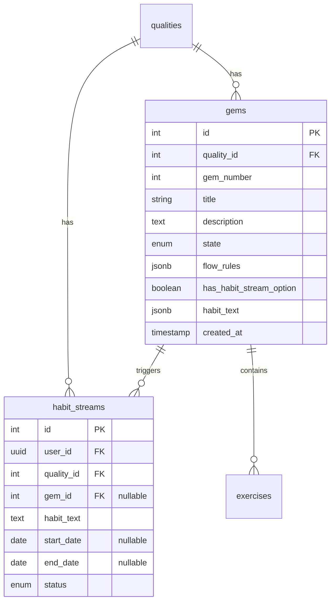
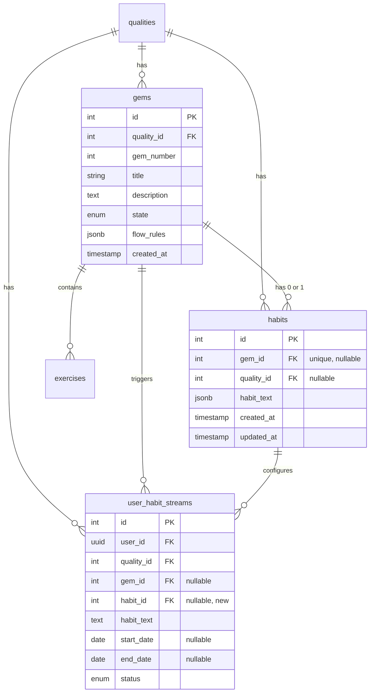

# Habit Streams Decoupling from Gems - Refactoring Plan

## Overview

This plan describes the refactoring to extract `habit_text` and `has_habit_stream_option` columns from the `gems` table into a new `habits` table. The `habits` table supports:

1. **Gem-linked habits** - habits tied to a specific gem (1:1 relationship via `gem_id`)
2. **Ad-hoc habits** - habits not linked to any gem, only to a quality (`gem_id` is NULL, `quality_id` is set)

This enables a cleaner data model where habit configuration is separate from gem content, and supports future extensibility for habit streams independent of gems.

The API contract (OpenAPI spec) remains unchanged - the `habitStream` object in the Gem response will be assembled by joining the new table.

**Naming Convention:**
- `habits` - The configuration table (replaces `gem_habits`). Contains habit templates linked to gems or ad-hoc.
- `user_habit_streams` - The user's active/completed habit streams (renamed from `habit_streams`). Tracks user progress.

---

## Entity Relationship Diagram (ERD)

### Current Schema



### Proposed Schema (After Migration)



### Key Changes

| Table | Column | Action |
|-------|--------|--------|
| `gems` | `has_habit_stream_option` | **DELETE** |
| `gems` | `habit_text` | **DELETE** |
| `habits` | `id` | **NEW** - PK, auto-increment |
| `habits` | `gem_id` | **NEW** - FK to gems, UNIQUE, nullable (null = ad-hoc) |
| `habits` | `quality_id` | **NEW** - FK to qualities, nullable (for ad-hoc habits) |
| `habits` | `habit_text` | **NEW** - JSONB, same structure as current gems.habit_text |
| `habits` | `created_at` | **NEW** - timestamp |
| `habits` | `updated_at` | **NEW** - timestamp |
| `user_habit_streams` | `habit_id` | **NEW** - FK to habits, nullable |

**Note:** The existing `habit_streams` table will be renamed to `user_habit_streams` in a separate migration to avoid confusion with the new `habits` configuration table.

---

## Migration Strategy

### Migration 1: Create New Table and Copy Data

**File:** `project-ihsan-backend/supabase/migrations/20260522000000_0031_create_habits_table.sql`

```sql
-- Migration 0031: Create habits table and migrate data from gems
-- This migration:
-- 1. Creates the new habits table (configuration table)
-- 2. Copies habit_text data from gems to habits where has_habit_stream_option = true
-- 3. Adds habit_id column to habit_streams table
-- 4. Does NOT delete columns from gems yet (done in migration 0032)
--
-- IDEMPOTENCY: All operations are safe to re-run without errors.

-- Step 1: Create the habits table (IF NOT EXISTS for idempotency)
CREATE TABLE IF NOT EXISTS public.habits (
    id INTEGER PRIMARY KEY GENERATED ALWAYS AS IDENTITY,
    gem_id INTEGER UNIQUE REFERENCES public.gems(id) ON DELETE CASCADE,
    quality_id INTEGER REFERENCES public.qualities(id) ON DELETE CASCADE,
    habit_text JSONB NOT NULL,
    created_at TIMESTAMP WITH TIME ZONE DEFAULT NOW(),
    updated_at TIMESTAMP WITH TIME ZONE DEFAULT NOW()
);

-- Step 2: Add indexes for performance (IF NOT EXISTS for idempotency)
CREATE INDEX IF NOT EXISTS idx_habits_gem_id ON public.habits(gem_id);
CREATE INDEX IF NOT EXISTS idx_habits_quality_id ON public.habits(quality_id);

-- Step 3: Add comments (comments are always idempotent - they just update)
COMMENT ON TABLE public.habits IS 'Habit configuration. Supports gem-linked habits (gem_id set) and ad-hoc habits (gem_id NULL, quality_id set).';
COMMENT ON COLUMN public.habits.gem_id IS 'FK to gems. UNIQUE, NULL for ad-hoc habits not tied to a specific gem.';
COMMENT ON COLUMN public.habits.quality_id IS 'FK to qualities. Required for ad-hoc habits, optional for gem-linked habits (inherited from gem).';
COMMENT ON COLUMN public.habits.habit_text IS 'JSONB containing habit text with baseHabit array structure.';

-- Step 4: Migrate data from gems to habits
-- Only copy gems that have has_habit_stream_option = true AND habit_text IS NOT NULL
-- Using ON CONFLICT DO NOTHING to make this idempotent - safe to re-run without errors
-- Note: This only runs if the source columns still exist (checked via DO block)
DO $$
BEGIN
    -- Only attempt migration if source columns still exist
    IF EXISTS (
        SELECT 1 FROM information_schema.columns
        WHERE table_schema = 'public'
        AND table_name = 'gems'
        AND column_name = 'has_habit_stream_option'
    ) AND EXISTS (
        SELECT 1 FROM information_schema.columns
        WHERE table_schema = 'public'
        AND table_name = 'gems'
        AND column_name = 'habit_text'
    ) THEN
        INSERT INTO public.habits (gem_id, quality_id, habit_text, created_at)
        SELECT
            g.id,
            g.quality_id,
            g.habit_text,
            g.created_at
        FROM public.gems g
        WHERE g.has_habit_stream_option = true
          AND g.habit_text IS NOT NULL
        ON CONFLICT (gem_id) DO NOTHING;
    END IF;
END $$;

-- Step 5: Add habit_id column to habit_streams (IF NOT EXISTS for idempotency)
DO $$
BEGIN
    IF NOT EXISTS (
        SELECT 1 FROM information_schema.columns
        WHERE table_schema = 'public'
        AND table_name = 'habit_streams'
        AND column_name = 'habit_id'
    ) THEN
        ALTER TABLE public.habit_streams ADD COLUMN habit_id INTEGER REFERENCES public.habits(id) ON DELETE SET NULL;
    END IF;
END $$;

-- Step 6: Create index on habit_streams.habit_id (IF NOT EXISTS for idempotency)
CREATE INDEX IF NOT EXISTS idx_habit_streams_habit_id ON public.habit_streams(habit_id);

-- Step 7: Populate habit_id in habit_streams based on existing gem_id relationships
-- This is idempotent - it just updates rows that match, no-op if already populated
UPDATE public.habit_streams uhs
SET habit_id = h.id
FROM public.habits h
WHERE uhs.gem_id = h.gem_id
  AND (uhs.habit_id IS NULL OR uhs.habit_id != h.id);

-- Step 8: Create updated_at trigger for habits
-- Function is idempotent (CREATE OR REPLACE), trigger creation checks existence
CREATE OR REPLACE FUNCTION public.update_updated_at_column()
RETURNS TRIGGER AS $$
BEGIN
    NEW.updated_at = NOW();
    RETURN NEW;
END;
$$ LANGUAGE plpgsql;

-- Drop and recreate trigger to be idempotent
DROP TRIGGER IF EXISTS update_habits_updated_at ON public.habits;
CREATE TRIGGER update_habits_updated_at
    BEFORE UPDATE ON public.habits
    FOR EACH ROW
    EXECUTE FUNCTION public.update_updated_at_column();
```

### Migration 2: Remove Old Columns from Gems

**File:** `project-ihsan-backend/supabase/migrations/20260522000001_0032_remove_habit_columns_from_gems.sql`

```sql
-- Migration 0032: Remove habit_text and has_habit_stream_option from gems table
-- This migration:
-- 1. Drops the has_habit_stream_option column from gems
-- 2. Drops the habit_text column from gems
-- Data has already been migrated to habits table in migration 0031
--
-- IDEMPOTENCY: Uses DROP COLUMN IF EXISTS - safe to re-run.
-- If columns are already dropped, this is a no-op.

-- Step 1: Drop the has_habit_stream_option column (IF EXISTS for idempotency)
ALTER TABLE public.gems DROP COLUMN IF EXISTS has_habit_stream_option;

-- Step 2: Drop the habit_text column (IF EXISTS for idempotency)
ALTER TABLE public.gems DROP COLUMN IF EXISTS habit_text;
```

### Migration 3: Rename habit_streams to user_habit_streams (Optional)

**File:** `project-ihsan-backend/supabase/migrations/20260522000002_0033_rename_habit_streams_to_user_habit_streams.sql`

```sql
-- Migration 0033: Rename habit_streams to user_habit_streams for clarity
-- This is a breaking change for any direct database queries, but the API remains unchanged
--
-- IDEMPOTENCY: Checks if old table name exists before renaming.
-- If already renamed, this is a no-op.

-- Step 1: Rename the table (only if old name exists)
DO $$
BEGIN
    IF EXISTS (
        SELECT 1 FROM information_schema.tables
        WHERE table_schema = 'public'
        AND table_name = 'habit_streams'
    ) AND NOT EXISTS (
        SELECT 1 FROM information_schema.tables
        WHERE table_schema = 'public'
        AND table_name = 'user_habit_streams'
    ) THEN
        ALTER TABLE public.habit_streams RENAME TO user_habit_streams;
    END IF;
END $$;

-- Step 2: Rename the sequence (only if old name exists)
DO $$
BEGIN
    IF EXISTS (
        SELECT 1 FROM information_schema.sequences
        WHERE sequence_schema = 'public'
        AND sequence_name = 'habit_streams_id_seq'
    ) THEN
        ALTER SEQUENCE public.habit_streams_id_seq RENAME TO user_habit_streams_id_seq;
    END IF;
END $$;

-- Step 3: Rename indexes (only if old name exists)
DO $$
BEGIN
    IF EXISTS (
        SELECT 1 FROM pg_indexes
        WHERE schemaname = 'public'
        AND indexname = 'idx_habit_streams_habit_id'
    ) THEN
        ALTER INDEX public.idx_habit_streams_habit_id RENAME TO idx_user_habit_streams_habit_id;
    END IF;
END $$;

-- Step 4: Update foreign key constraints in user_habit_stream_progress
-- Drop and recreate constraint (idempotent pattern)
DO $$
BEGIN
    -- Only update if the table references the old table name
    IF EXISTS (
        SELECT 1 FROM information_schema.tables
        WHERE table_schema = 'public'
        AND table_name = 'user_habit_streams'
    ) THEN
        -- Drop old constraint if it exists
        IF EXISTS (
            SELECT 1 FROM information_schema.table_constraints
            WHERE constraint_schema = 'public'
            AND constraint_name = 'user_habit_stream_progress_habit_stream_id_fkey'
            AND table_name = 'user_habit_stream_progress'
        ) THEN
            ALTER TABLE public.user_habit_stream_progress
                DROP CONSTRAINT user_habit_stream_progress_habit_stream_id_fkey;
        END IF;
        
        -- Add constraint pointing to new table name (if not already exists with correct reference)
        IF NOT EXISTS (
            SELECT 1 FROM information_schema.table_constraints
            WHERE constraint_schema = 'public'
            AND constraint_name = 'user_habit_stream_progress_habit_stream_id_fkey'
            AND table_name = 'user_habit_stream_progress'
        ) THEN
            ALTER TABLE public.user_habit_stream_progress
                ADD CONSTRAINT user_habit_stream_progress_habit_stream_id_fkey
                FOREIGN KEY (habit_stream_id) REFERENCES public.user_habit_streams(id) ON DELETE CASCADE;
        END IF;
    END IF;
END $$;

-- Step 5: Update any views that reference habit_streams
-- Check for views and update them accordingly
DO $$
DECLARE
    view_record RECORD;
BEGIN
    FOR view_record IN
        SELECT table_name, view_definition
        FROM information_schema.views
        WHERE view_definition LIKE '%habit_streams%'
          AND table_schema = 'public'
    LOOP
        -- Log which views need updating (adjust as needed)
        RAISE NOTICE 'View % may need updating to reference user_habit_streams instead of habit_streams', view_record.table_name;
    END LOOP;
END $$;
```

---

## Backend Repository Layer Changes

### 1. Gems Repository (`project-ihsan-backend/supabase/functions/repositories/gems-repository.ts`)

**Changes to `GemsDatabaseResponse` interface:**

```typescript
// BEFORE
export interface GemsDatabaseResponse {
  id: number
  title: string
  description: string
  gem_number: number
  state: 'DRAFT' | 'PUBLISHED'
  flow_rules: any
  has_habit_stream_option: boolean
  habit_text: {
    baseHabit: Array<{
      text: string
      type: string
    }>
  } | null
  quality: { ... }
  exercises: [...]
}

// AFTER
export interface GemsDatabaseResponse {
  id: number
  title: string
  description: string
  gem_number: number
  state: 'DRAFT' | 'PUBLISHED'
  flow_rules: any
  habit: {
    id: number
    habit_text: {
      baseHabit: Array<{
        text: string
        type: string
      }>
    }
  } | null
  quality: { ... }
  exercises: [...]
}
```

**Changes to `fetchGemById` query:**

```typescript
// BEFORE
const { data, error } = await supabaseClient
  .from('gems')
  .select(`
    id, title, description, gem_number, state, flow_rules,
    has_habit_stream_option, habit_text,
    quality:qualities!inner (id, name, state),
    exercises (id, default_order, type, content)
  `)
  .eq('id', gemId)
  .single()

// AFTER
const { data, error } = await supabaseClient
  .from('gems')
  .select(`
    id, title, description, gem_number, state, flow_rules,
    habit:habits (id, habit_text),
    quality:qualities!inner (id, name, state),
    exercises (id, default_order, type, content)
  `)
  .eq('id', gemId)
  .single()
```

### 2. Habit Streams Repository (`project-ihsan-backend/supabase/functions/repositories/habit-streams-repository.ts`)

**Changes to `GemWithHabitInfo` interface:**

```typescript
// BEFORE
export interface GemWithHabitInfo {
  id: number
  quality_id: number
  has_habit_stream_option: boolean
  habit_text: {
    baseHabit: Array<{
      text: string
      type: string
      references?: [...]
    }>
  } | null
}

// AFTER
export interface GemWithHabitInfo {
  id: number
  quality_id: number
  habit: {
    id: number
    habit_text: {
      baseHabit: Array<{
        text: string
        type: string
        references?: [...]
      }>
    }
  } | null
}
```

**Changes to `getGemWithHabitInfo` method:**

```typescript
// BEFORE
const { data, error } = await supabaseClient
  .from('gems')
  .select('id, quality_id, has_habit_stream_option, habit_text')
  .eq('id', gemId)
  .maybeSingle()

// AFTER
const { data, error } = await supabaseClient
  .from('gems')
  .select('id, quality_id, habit:habits (id, habit_text)')
  .eq('id', gemId)
  .maybeSingle()
```

**New method: `getHabitByGemId`**

```typescript
/**
 * Fetches habit record for a given gem ID
 */
public async getHabitByGemId(gemId: number): Promise<{
  id: number
  gem_id: number
  quality_id: number
  habit_text: any
} | null> {
  const supabaseClient = createSupabaseClient()
  
  const { data, error } = await supabaseClient
    .from('habits')
    .select('id, gem_id, quality_id, habit_text')
    .eq('gem_id', gemId)
    .maybeSingle()
    
  if (error) {
    console.error(`[HabitStreamsRepository] Error fetching habit for gem ${gemId}:`, error)
    throw new Error(`Failed to fetch habit: ${error.message}`)
  }
  
  return data
}
```

**Changes to `createHabitStream` and `createAndActivateHabitStream`:**

These methods should now accept an optional `habitId` parameter and store it in the new column.

```typescript
public async createHabitStream(
  userId: string,
  qualityId: number,
  gemId: number,
  habitText: string,
  habitId?: number, // NEW optional parameter
): Promise<HabitStreamDatabaseResponse> {
  const habitStreamData = {
    user_id: userId,
    quality_id: qualityId,
    gem_id: gemId,
    habit_id: habitId, // NEW
    habit_text: habitText,
    start_date: null,
    end_date: null,
    status: HabitStreamStatus.NOT_STARTED,
  }
  // ... rest of the method
}
```

### 3. New Habits Repository (NEW FILE)

**File:** `project-ihsan-backend/supabase/functions/repositories/habits-repository.ts`

```typescript
/**
 * Habits Repository
 * Handles database operations for habits table (configuration)
 */

import { createSupabaseClient } from '../shared/supabase-client.ts'

export interface HabitDatabaseResponse {
  id: number
  gem_id: number | null
  quality_id: number | null
  habit_text: {
    baseHabit: Array<{
      text: string
      type: string
      references?: Array<{
        gemId: number
        answerPath: string
        exerciseId: number
        displayText: string
        exerciseName: string
        exerciseType: string
        templateVariable: string
      }>
    }>
  }
  created_at: string
  updated_at: string
}

export interface IHabitsRepository {
  getHabitById(id: number): Promise<HabitDatabaseResponse | null>
  getHabitByGemId(gemId: number): Promise<HabitDatabaseResponse | null>
  getHabitsByQualityId(qualityId: number): Promise<HabitDatabaseResponse[]>
  createHabit(data: {
    gem_id?: number
    quality_id?: number
    habit_text: any
  }): Promise<HabitDatabaseResponse>
  updateHabit(id: number, data: {
    habit_text?: any
  }): Promise<HabitDatabaseResponse>
  deleteHabit(id: number): Promise<void>
}

export class HabitsRepository implements IHabitsRepository {
  // Implement all methods...
}
```

---

## Backend Service Layer Changes

### 1. Habit Stream Service (`project-ihsan-backend/supabase/functions/services/habit-stream-service.ts`)

The service layer needs minimal changes since the API contract remains the same. The main changes are:

1. **When creating a habit stream from a gem:** Look up the `habit` record to get the habit text and `habit_id`.
2. **When returning habit stream data:** The `habit_id` is stored but not exposed in the API.

### 2. Content Management Service

The service that assembles the Gem response needs to transform the `habit` data into the existing `habitStream` response format:

```typescript
// In the response assembly logic:
const response: GetGemResponse = {
  id: gem.id,
  title: gem.title,
  // ... other fields
  habitStream: gem.habit ? {
    hasHabitStream: true,
    habitText: this.buildHabitText(gem.habit.habit_text, userId)
  } : {
    hasHabitStream: false,
    habitText: null
  }
}
```

---

## Admin Interface Changes

### 1. Admin Gems Repository (`project-ihsan-admin/lib/services/supabase/services/database/gems-repository.ts`)

**Changes to `SaveGemPayload` and `UpdateGemPayload`:**

```typescript
// BEFORE
export type SaveGemPayload = {
  qualityId: number
  title: string
  gemNumber: number
  state: GemState
  hasHabitStreamOption?: boolean
  habitText?: Record<string, unknown>
}

export type UpdateGemPayload = {
  id: number
  title: string
  flow_rules?: Record<string, unknown> | null
  hasHabitStreamOption?: boolean
  habitText?: Record<string, unknown>
}

// AFTER
export type SaveGemPayload = {
  qualityId: number
  title: string
  gemNumber: number
  state: GemState
  gemHabit?: {
    habitText: Record<string, unknown>
  }
}

export type UpdateGemPayload = {
  id: number
  title: string
  flow_rules?: Record<string, unknown> | null
  gemHabit?: {
    habitText: Record<string, unknown>
  } | null  // null to remove habit
}
```

**Changes to `createGem` method:**

```typescript
// BEFORE
const insertData: Record<string, unknown> = {
  quality_id: qualityId,
  title,
  gem_number: gemNumber,
  state
}
if (hasHabitStreamOption !== undefined) {
  insertData.has_habit_stream_option = hasHabitStreamOption
}
if (habitText !== undefined) {
  insertData.habit_text = habitText
}

// AFTER
const insertData: Record<string, unknown> = {
  quality_id: qualityId,
  title,
  gem_number: gemNumber,
  state
}

// Return the created gem ID for subsequent habit creation
const { data, error } = await this.getClient()
  .from('gems')
  .insert(insertData)
  .select()
  .single()

// If gemHabit is provided, create the habit record
if (data && gemHabit) {
  await this.getClient()
    .from('habits')
    .insert({
      gem_id: data.id,
      quality_id: qualityId,
      habit_text: gemHabit.habitText
    })
}
```

**Changes to `updateGem` method:**

```typescript
// Similar pattern - update habits table instead of gems columns
```

### 2. GemForm Component (`project-ihsan-admin/components/forms/GemForm.tsx`)

**Changes to props interface:**

```typescript
// BEFORE
interface GemFormProps {
  formData: {
    title: string
    gemNumber: number
    flowRules?: FlowRules | null
    hasHabitStreamOption?: boolean
    defaultHabitText?: JSONContent
  }
  onHabitStreamChange: (hasOption: boolean, text?: JSONContent) => void
  // ...
}

// AFTER
interface GemFormProps {
  formData: {
    title: string
    gemNumber: number
    flowRules?: FlowRules | null
    gemHabit?: {
      habitText: JSONContent
    } | null
  }
  onGemHabitChange: (gemHabit: { habitText: JSONContent } | null) => void
  // ...
}
```

**Changes to the habit stream UI section:**

```typescript
// BEFORE
<Checkbox
  id="hasHabitStreamOption"
  checked={formData.hasHabitStreamOption || false}
  onCheckedChange={(checked) => {
    onHabitStreamChange(checked as boolean, checked ? formData.defaultHabitText : undefined)
  }}
/>

// AFTER
<Checkbox
  id="hasHabitStreamOption"
  checked={!!formData.gemHabit}
  onCheckedChange={(checked) => {
    onGemHabitChange(checked ? { habitText: formData.gemHabit?.habitText || defaultHabitContent } : null)
  }}
/>
```

### 3. Admin Page Handlers

Update the page-level action handlers in:
- `project-ihsan-admin/app/(admin-panel)/qualities/[qualityId]/gems/new/page.tsx`
- `project-ihsan-admin/app/(admin-panel)/qualities/[qualityId]/gems/[gemId]/edit/page.tsx`

These need to use the new `gemHabit` structure instead of `hasHabitStreamOption` + `defaultHabitText`.

---

## RLS Policies

Add RLS policies for the new `habits` table:

```sql
-- Enable RLS on habits
ALTER TABLE public.habits ENABLE ROW LEVEL SECURITY;

-- Allow authenticated users to read habits
CREATE POLICY "Allow authenticated users to read habits"
  ON public.habits
  FOR SELECT
  TO authenticated
  USING (true);

-- Allow admin/master_admin roles to manage habits
CREATE POLICY "Allow admins to manage habits"
  ON public.habits
  FOR ALL
  TO authenticated
  USING (
    EXISTS (
      SELECT 1 FROM auth.users
      WHERE auth.users.id = auth.uid()
      AND auth.users.raw_user_meta_data->>'role' IN ('master_admin', 'admin')
    )
  )
  WITH CHECK (
    EXISTS (
      SELECT 1 FROM auth.users
      WHERE auth.users.id = auth.uid()
      AND auth.users.raw_user_meta_data->>'role' IN ('master_admin', 'admin')
    )
  );
```

---

## Implementation Order

1. **Create migration 0031** - Create `habits` table, copy data, add `habit_id` to `habit_streams`
2. **Run migration 0031** on staging
3. **Verify data integrity** - Check that all habits records were created correctly
4. **Create migration 0032** - Remove old columns from `gems`
5. **Run migration 0032** on staging
6. **(Optional) Create and run migration 0033** - Rename `habit_streams` to `user_habit_streams`
7. **Update backend repositories** - gems-repository.ts, habit-streams-repository.ts
8. **Create new repository** - habits-repository.ts
9. **Update backend services** - habit-stream-service.ts, content-management service
10. **Update admin repositories** - gems-repository.ts
11. **Update admin components** - GemForm.tsx, new/edit page handlers
12. **Add RLS policies** for habits table
13. **Test end-to-end** on staging
14. **Deploy to production**

---

## Data Integrity Verification Queries

After running migration 0031, verify data integrity:

```sql
-- Verify all gems with has_habit_stream_option=true have corresponding habits records
SELECT g.id, g.has_habit_stream_option, h.id as habit_id
FROM gems g
LEFT JOIN habits h ON g.id = h.gem_id
WHERE g.has_habit_stream_option = true
AND h.id IS NULL;
-- Should return 0 rows

-- Verify habit_streams have correct habit_id populated
SELECT uhs.id, uhs.gem_id, uhs.habit_id, h.id as expected_habit_id
FROM habit_streams uhs
LEFT JOIN habits h ON uhs.gem_id = h.gem_id
WHERE uhs.gem_id IS NOT NULL
AND uhs.habit_id IS DISTINCT FROM h.id;
-- Should return 0 rows

-- Count comparison
SELECT 
  (SELECT COUNT(*) FROM gems WHERE has_habit_stream_option = true) as gems_with_habits,
  (SELECT COUNT(*) FROM habits) as habits_records;
-- Should be equal
```

---

## Risk Assessment

| Risk | Mitigation |
|------|------------|
| Data loss during migration | Migration copies data first, deletes columns only in second migration |
| API breaking changes | API response format remains unchanged by transforming habit data |
| Habit streams lose gem linkage | habit_id is populated from existing relationships |
| Admin UI breaks | Update admin code in same deployment as backend changes |

---

## Rollback Plan

If issues arise after migration 0031:
1. Restore `has_habit_stream_option` and `habit_text` columns to gems
2. Copy data back from habits
3. Drop habits table
4. Remove habit_id from habit_streams

If issues arise after migration 0032:
1. Re-add columns to gems
2. Copy data back from habits
3. This is more complex - prefer fixing forward

---

## Files to Modify

### Backend (Supabase Edge Functions)
- [ ] `project-ihsan-backend/supabase/migrations/20260522000000_0031_create_habits_table.sql` (NEW)
- [ ] `project-ihsan-backend/supabase/migrations/20260522000001_0032_remove_habit_columns_from_gems.sql` (NEW)
- [ ] `project-ihsan-backend/supabase/migrations/20260522000002_0033_rename_habit_streams_to_user_habit_streams.sql` (NEW, optional)
- [ ] `project-ihsan-backend/supabase/functions/repositories/gems-repository.ts`
- [ ] `project-ihsan-backend/supabase/functions/repositories/habit-streams-repository.ts`
- [ ] `project-ihsan-backend/supabase/functions/repositories/habits-repository.ts` (NEW)
- [ ] `project-ihsan-backend/supabase/functions/services/habit-stream-service.ts`
- [ ] `project-ihsan-backend/supabase/functions/content-management/index.ts` (response assembly)

### Admin (Next.js)
- [ ] `project-ihsan-admin/lib/services/supabase/services/database/gems-repository.ts`
- [ ] `project-ihsan-admin/components/forms/GemForm.tsx`
- [ ] `project-ihsan-admin/app/(admin-panel)/qualities/[qualityId]/gems/new/page.tsx`
- [ ] `project-ihsan-admin/app/(admin-panel)/qualities/[qualityId]/gems/[gemId]/edit/page.tsx`
- [ ] `project-ihsan-admin/app/(admin-panel)/qualities/[qualityId]/gems/actions.ts` (or equivalent action file)
