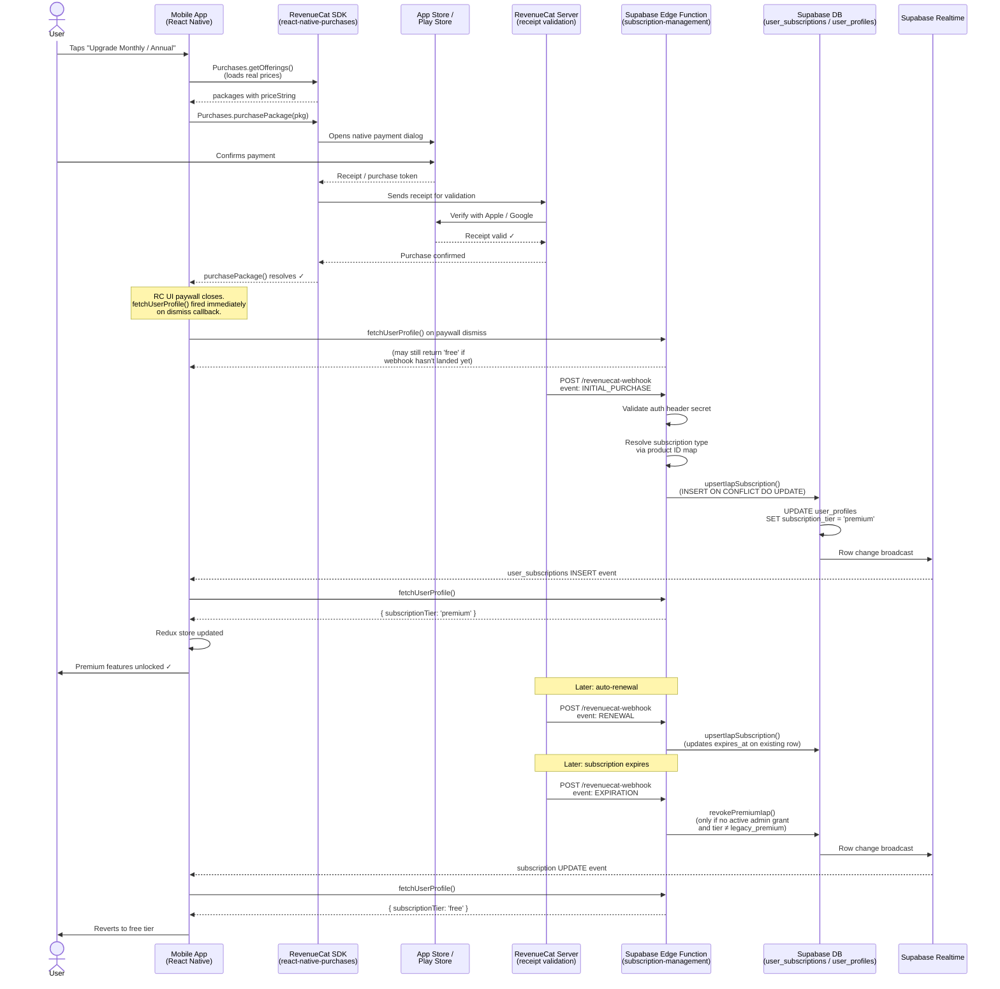

# Plan: In-App Purchase Integration (RevenueCat)

## Summary

Wire RevenueCat into the mobile app and backend so that buying a subscription on the
App Store or Google Play updates `user_profiles.subscription_tier` in Supabase, which
triggers the existing Realtime sync (`useSubscriptionSync`) to unlock premium features
on the device without any manual refresh.

Seasonal pack IAP, free trials, and grace periods are out of scope for this phase.

---

## Architecture

The mobile app **never** calls `grantPremium` directly. It only initiates the store
dialog. The backend decides truth from the RevenueCat webhook. Supabase is the single
source of truth for entitlements — both app UI and backend enforcement read from
`user_profiles.subscription_tier`, so admin-granted and IAP-granted subscriptions
behave identically.

---

## Flow Diagram




---

## Known Risks & Mitigations

These are addressed in the implementation phases below. Listed here for visibility.


| Severity   | Risk                                                                                                                | Mitigation                                                                                                                             |
| ---------- | ------------------------------------------------------------------------------------------------------------------- | -------------------------------------------------------------------------------------------------------------------------------------- |
| **High**   | Webhook lag: user paid but app still shows free tier for 1–4s                                                       | Call `fetchUserProfile()` immediately in the RC UI paywall dismiss callback — fires on every close regardless of outcome               |
| **High**   | Admin grant wiped by IAP expiration: `EXPIRATION` webhook calls `revokePremium()` which cancels admin rows too      | Introduce `revokePremiumIap()` — only cancels IAP rows; checks if admin grant still active before downgrading tier                     |
| **High**   | `legacy_premium` tier overwritten by IAP expiration                                                                 | `revokePremiumIap()` skips downgrade entirely if current tier is `legacy_premium`                                                      |
| **Medium** | Fragile product ID parsing: `productId.includes('annual')` breaks if product IDs change                             | Use an explicit `PRODUCT_TYPE_MAP` constant in the webhook handler                                                                     |
| **Medium** | `Purchases.logIn()` not called before purchase: webhook carries anonymous RC ID, backend can't map to Supabase user | Paywall is only reachable inside authenticated navigator where `logIn()` has already been called; enforced as architectural constraint |
| **Medium** | Refunds not handled: refunded user keeps premium access                                                             | Add `REFUND` event case → immediate `revokePremiumIap()`                                                                               |


---

## Deployment Target

All backend changes go to the **Supabase staging project `znjkyjbbycnajxepyjfi`**, and
the mobile app runs against the **RevenueCat sandbox (Test Store)** for this phase. Both
the migration and the edge function deploy to this single project ref.

```bash
# Never run without explicit user confirmation:
supabase db push --project-ref znjkyjbbycnajxepyjfi
supabase functions deploy subscription-management --project-ref znjkyjbbycnajxepyjfi
```

---

## Phase 1 — RevenueCat Project Setup (external — no code)

### Current state (as of 2026-06-01)

**Phase 1 is essentially complete for iOS. This phase ships iOS-only — Android is
deferred to a follow-up.**

| Item | Status |
|---|---|
| RevenueCat project "Sabiqoon" | ✅ Created |
| `default` offering (2 packages) | ✅ Created |
| `premium` entitlement ("Sabiqoon Premium", 2 products) | ✅ Created |
| `test` entitlement ("Sabiqoon Test") | ✅ Deleted |
| iOS app added + store credentials | ✅ Done |
| Android app added + store credentials | ⏭️ Deferred — iOS only for now |
| Real store products (App Store Connect) | ✅ Created (iOS) |
| Real store products (Google Play) | ⏭️ Deferred — iOS only for now |
| Webhook configured | ✅ Done |
| Paywall template designed | ✅ Done |

All RevenueCat dashboard setup is complete for the iOS sandbox flow. The remaining work
in this plan is code (Phases 2–8). Android store setup and product creation happen in a
later phase when Google Play is ready.

### 1.1 ✅ RevenueCat project, entitlements, offerings — done

Project "Sabiqoon" exists. `default` offering, `premium` entitlement, and the iOS
products are created. The unused `test` entitlement has been deleted.

### 1.2 ✅ Store credentials — iOS done

iOS App Store Connect API key is uploaded to RevenueCat. **Android Play Store
credentials are deferred** until the Android launch.

### 1.3 ✅ Store products — iOS done

The two iOS auto-renewable products are created in App Store Connect and attached to
the `premium` entitlement and `default` offering. Confirm their exact identifiers in
RevenueCat → Entitlements → `premium` → Associated products and use them in the
`PRODUCT_TYPE_MAP` (Phase 4.3).

**Android (deferred):** when Google Play is ready, create matching subscription products
in Google Play Console (reuse the same product IDs as iOS for simplicity), attach them
to the `premium` entitlement and `default` offering, and add the Android products to
`PRODUCT_TYPE_MAP`. Prices are set per-store and can differ by region.

### 1.4 ✅ Entitlements and Offerings — already done

`premium` entitlement and `default` offering exist. Once real store products are
created (1.3), attach them to the `premium` entitlement and `default` offering packages.

The entitlement is used by RevenueCat's dashboard analytics and by `restorePurchases()`
to check if a restored subscription is active. It is **not** used to gate features in
the app — Supabase `subscription_tier` does that.

### Confirm actual product identifiers before writing the `PRODUCT_TYPE_MAP`

The `PRODUCT_TYPE_MAP` in the webhook handler (Phase 4.3) must use the exact product
identifiers as registered in the stores. Check RevenueCat dashboard → Entitlements →
`premium` → Associated products to see the identifiers once the real products are
attached. The plan uses `io.sabiqoon.premium.monthly` / `io.sabiqoon.premium.annual`
as placeholders — update the map to match whatever identifiers are actually registered.

### 1.5 ✅ Webhook configured — done

The webhook is set up in RevenueCat → Project Settings → Webhooks pointing at
`https://znjkyjbbycnajxepyjfi.supabase.co/functions/v1/subscription-management/revenuecat-webhook`
with an Authorization header secret.

**Action remaining:** ensure that same secret value is stored as the Supabase secret
`REVENUECAT_WEBHOOK_AUTH_HEADER` on `znjkyjbbycnajxepyjfi` (Phase 4.2 / Phase 8). The
webhook handler does not exist yet, so test sends will 404 until Phase 4–6 are deployed.

### 1.6 API keys — sandbox keys already configured

**This phase targets the RevenueCat sandbox (Test Store) for the Supabase staging
project `znjkyjbbycnajxepyjfi`.** The sandbox API keys are already present in
`project-ihsan/.env.staging`:

```
REVENUECAT_API_KEY_IOS=test_ezmKZGfjbgaMFfBsdnZiDWMuiiV
REVENUECAT_API_KEY_ANDROID=test_ezmKZGfjbgaMFfBsdnZiDWMuiiV
```

The `test_...` prefix is RevenueCat's **Test Store** key — it lets you exercise the
full purchase flow without real App Store / Play Store products or charges. The same
key is used for both platforms in the sandbox.

When moving to production later, the App Store key (`appl_...`) and Play Store key
(`goog_...`) replace these in `.env.production`. Do not commit production keys to the
staging env file.

These keys are safe to embed in the app. They only initiate purchases; they cannot
read customer data or validate receipts without the secret key.

---

## Phase 2 — Backend: Schema Migration

**File:** `project-ihsan-backend/supabase/migrations/20260531000001_0046_add_iap_columns_to_user_subscriptions.sql`

```sql
-- Track which store produced the subscription row
CREATE TYPE public.subscription_platform AS ENUM ('apple', 'google', 'admin');

ALTER TABLE public.user_subscriptions
  ADD COLUMN platform             public.subscription_platform NOT NULL DEFAULT 'admin',
  ADD COLUMN store_product_id     TEXT,
  ADD COLUMN store_transaction_id TEXT,
  ADD COLUMN revenuecat_event_type TEXT;

-- Unique constraint to prevent duplicate grants for the same store transaction.
-- Partial index so admin rows (store_transaction_id IS NULL) are not affected.
CREATE UNIQUE INDEX idx_user_subscriptions_store_transaction
  ON public.user_subscriptions (store_transaction_id)
  WHERE store_transaction_id IS NOT NULL;
```

`store_transaction_id` is set to RevenueCat's `original_transaction_id` (stable across
renewals for the same subscription). This prevents double-processing if RevenueCat
delivers the same webhook twice.

---

## Phase 3 — Backend: Repository + Service Updates

### 3.1 Update `UserSubscription` interface

**File:** `project-ihsan-backend/supabase/functions/repositories/subscription-repository.ts`

Add new fields to the `UserSubscription` interface:

```typescript
export interface UserSubscription {
  // ... existing fields ...
  platform: 'apple' | 'google' | 'admin'
  store_product_id: string | null
  store_transaction_id: string | null
  revenuecat_event_type: string | null
}
```

### 3.2 Add `upsertIapSubscription` method to repository

This is the primary method called by the webhook handler for `INITIAL_PURCHASE` and
`RENEWAL`. It upserts on `store_transaction_id` to guarantee idempotency.

```typescript
public async upsertIapSubscription(params: {
  userId: string
  subscriptionType: 'premium_monthly' | 'premium_annual'
  platform: 'apple' | 'google'
  storeProductId: string
  storeTransactionId: string
  startsAt: string
  expiresAt: string
  revenuecatEventType: string
}): Promise<void>
```

Implementation:

1. `INSERT INTO user_subscriptions (...) ON CONFLICT (store_transaction_id) DO UPDATE SET expires_at = EXCLUDED.expires_at, status = 'active', revenuecat_event_type = EXCLUDED.revenuecat_event_type`
2. `UPDATE user_profiles SET subscription_tier = 'premium' WHERE user_id = $userId`

This single method covers both `INITIAL_PURCHASE` (new row) and `RENEWAL` (updates
`expires_at` on the existing row via the conflict clause).

### 3.3 Add `revokePremiumIap` method (replaces direct `revokePremium` in webhook)

**[HIGH]** The existing `revokePremium()` cancels ALL active premium subscriptions
including admin-granted ones, and unconditionally sets `subscription_tier = 'free'`.
Calling it from the webhook would wipe admin grants and downgrade `legacy_premium` users.

Add a new IAP-specific revoke method:

```typescript
public async revokePremiumIap(userId: string): Promise<void> {
  const supabase = createSupabaseClient()

  // Only cancel IAP-sourced rows — never touch admin-granted subscriptions
  const { error: cancelError } = await supabase
    .from('user_subscriptions')
    .update({ status: 'cancelled' })
    .eq('user_id', userId)
    .in('subscription_type', ['premium_monthly', 'premium_annual'])
    .eq('status', 'active')
    .eq('granted_by_admin', false)

  if (cancelError) {
    throw new Error(`Failed to cancel IAP subscription: ${cancelError.message}`)
  }

  // Only downgrade tier if no active admin grant remains and not legacy_premium
  const { data: profile, error: profileError } = await supabase
    .from('user_profiles')
    .select('subscription_tier')
    .eq('user_id', userId)
    .single()

  if (profileError) {
    throw new Error(`Failed to read user tier: ${profileError.message}`)
  }

  // Never overwrite legacy_premium — it is permanent
  if (profile.subscription_tier === 'legacy_premium') {
    return
  }

  // Check if an admin grant is still active before downgrading
  const { data: adminSubs } = await supabase
    .from('user_subscriptions')
    .select('id')
    .eq('user_id', userId)
    .eq('status', 'active')
    .eq('granted_by_admin', true)
    .or('expires_at.is.null,expires_at.gt.' + new Date().toISOString())

  if (adminSubs && adminSubs.length > 0) {
    // Admin grant still active — do not downgrade tier
    return
  }

  const { error: tierError } = await supabase
    .from('user_profiles')
    .update({ subscription_tier: 'free' })
    .eq('user_id', userId)

  if (tierError) {
    throw new Error(`Failed to update subscription tier: ${tierError.message}`)
  }
}
```

The original `revokePremium()` is kept unchanged for the admin portal (which should be
able to override everything).

### 3.4 Update `grantPremium` signature

The existing `grantPremium` is used by the admin portal API route. Update it to accept
an optional `subscriptionType` parameter:

```typescript
public async grantPremium(
  userId: string,
  startsAt: string,
  expiresAt: string,
  grantedByAdmin: boolean,
  subscriptionType: 'premium_monthly' | 'premium_annual' = 'premium_monthly',
): Promise<void>
```

### 3.5 Update ISubscriptionRepository interface

Add `upsertIapSubscription` and `revokePremiumIap` to the interface definition so
TypeScript enforces both.

---

## Phase 4 — Backend: RevenueCat Webhook Handler

**File:** `project-ihsan-backend/supabase/functions/subscription-management/index.ts`

Add a new route branch and handler function. No new edge function is needed — this
extends the existing `subscription-management` function.

### 4.1 Add route in `serve()` dispatcher

```typescript
if (entity === 'revenuecat-webhook') {
  return handleRevenueCatWebhook(req)
}
```

### 4.2 Add Supabase secret

```bash
# Run once — ask user before executing
supabase secrets set REVENUECAT_WEBHOOK_AUTH_HEADER="<the secret you set in RC dashboard>" \
  --project-ref znjkyjbbycnajxepyjfi
```

### 4.3 Webhook handler implementation

```typescript
// [MEDIUM] Explicit map — never use productId.includes('annual').
// Product identifiers must match exactly what is registered in App Store Connect
// and Google Play Console, as confirmed in RevenueCat → Entitlements → premium.
// Update this map if product IDs change or new products are added.
const PRODUCT_TYPE_MAP: Record<string, 'premium_monthly' | 'premium_annual'> = {
  'io.sabiqoon.premium.monthly': 'premium_monthly',
  'io.sabiqoon.premium.annual':  'premium_annual',
}

async function handleRevenueCatWebhook(req: Request): Promise<Response> {
  if (req.method !== 'POST') {
    return createErrorResponse('Method not allowed', HTTP_STATUS.METHOD_NOT_ALLOWED)
  }

  // Validate shared secret
  const authHeader = req.headers.get('authorization') ?? ''
  const expectedSecret = Deno.env.get('REVENUECAT_WEBHOOK_AUTH_HEADER') ?? ''
  if (!expectedSecret || authHeader !== expectedSecret) {
    return createErrorResponse('Unauthorized', HTTP_STATUS.FORBIDDEN)
  }

  const body = await req.json()
  const event = body?.event

  if (!event || !event.app_user_id) {
    return createErrorResponse('Invalid webhook payload', HTTP_STATUS.BAD_REQUEST)
  }

  const userId: string = event.app_user_id  // = Supabase UUID (set via Purchases.logIn)
  const eventType: string = event.type
  const productId: string = event.product_id ?? ''
  const transactionId: string = event.original_transaction_id ?? event.id ?? ''
  const expiresAtMs: number | null = event.expiration_at_ms ?? null
  const purchasedAtMs: number = event.purchased_at_ms ?? Date.now()
  const store: string = event.store ?? ''

  const platform: 'apple' | 'google' = store === 'APP_STORE' ? 'apple' : 'google'

  // [MEDIUM] Use explicit map rather than string matching
  const subscriptionType = PRODUCT_TYPE_MAP[productId] ?? 'premium_monthly'

  const startsAt = new Date(purchasedAtMs).toISOString()
  const expiresAt = expiresAtMs ? new Date(expiresAtMs).toISOString() : null

  console.log(`[RevenueCat Webhook] event=${eventType} userId=${userId} product=${productId}`)

  switch (eventType) {
    case 'INITIAL_PURCHASE':
    case 'RENEWAL':
    case 'UNCANCELLATION': {
      // UNCANCELLATION = user re-enables auto-renew; treat same as renewal
      if (!expiresAt) {
        return createErrorResponse('Missing expiration_at_ms', HTTP_STATUS.BAD_REQUEST)
      }
      await subscriptionRepository.upsertIapSubscription({
        userId,
        subscriptionType,
        platform,
        storeProductId: productId,
        storeTransactionId: transactionId,
        startsAt,
        expiresAt,
        revenuecatEventType: eventType,
      })
      break
    }

    case 'EXPIRATION': {
      // [HIGH] Use revokePremiumIap — protects admin grants and legacy_premium
      await subscriptionRepository.revokePremiumIap(userId)
      break
    }

    case 'REFUND': {
      // [MEDIUM] Immediate revoke — user got their money back
      await subscriptionRepository.revokePremiumIap(userId)
      break
    }

    case 'CANCELLATION': {
      // User turned off auto-renew but is still in their paid period.
      // DO NOT revoke yet — wait for EXPIRATION event.
      console.log(`[RevenueCat Webhook] CANCELLATION for ${userId} — waiting for EXPIRATION`)
      break
    }

    case 'BILLING_ISSUE': {
      // Payment failed — RevenueCat will retry. Don't revoke.
      console.log(`[RevenueCat Webhook] BILLING_ISSUE for ${userId} — no action taken`)
      break
    }

    default:
      console.log(`[RevenueCat Webhook] Unhandled event type: ${eventType}`)
  }

  // RevenueCat expects a 200 quickly — always return success after processing
  return createSuccessResponse({ received: true }, HTTP_STATUS.OK)
}
```

### Key design decisions


| Decision                                       | Reason                                                                                                    |
| ---------------------------------------------- | --------------------------------------------------------------------------------------------------------- |
| `CANCELLATION` → no revoke                     | User still has access until period ends. EXPIRATION is the authoritative end event.                       |
| `BILLING_ISSUE` → no revoke                    | RevenueCat has a billing retry window. Revoking early would penalise users unfairly.                      |
| `REFUND` → immediate revoke                    | User received their money back — access should end immediately.                                           |
| `UNCANCELLATION` → upsert                      | User re-enabled auto-renew — existing row gets `expires_at` refreshed.                                    |
| `EXPIRATION` / `REFUND` use `revokePremiumIap` | Protects admin grants and `legacy_premium` from being overwritten.                                        |
| Idempotency via `store_transaction_id`         | RevenueCat can deliver the same webhook twice. The `ON CONFLICT` upsert makes the handler safe to replay. |


---

## Phase 5 — Mobile: Install & Configure RevenueCat

### 5.1 Install SDKs

```bash
cd project-ihsan
yarn add react-native-purchases react-native-purchases-ui
cd ios && pod install
```

`react-native-purchases` — core purchase SDK (offerings, purchase flow, restore).
`react-native-purchases-ui` — pre-built paywall UI rendered by RevenueCat. Replaces
the custom `PremiumPaywallBottomSheet` component entirely.

### 5.2 iOS: Add StoreKit capability

In Xcode: select the `project-ihsan` target → Signing & Capabilities → "+ Capability"
→ "In-App Purchase". This must be done for both Debug and Release configurations.

### 5.3 Android: deferred

Android is out of scope for this phase (no Play Store products or credentials yet).
The `Platform.OS === 'ios' ? ... : ...` branch in `initRevenueCat` (5.4) keeps the
Android path safe — the sandbox key is the same `test_...` value, so the app won't
crash on Android, but no real Android purchase flow exists until the Android launch.

When Android ships: no Gradle dependency needed (`react-native-purchases` ships
pre-built AAR files); the `BILLING` permission is added automatically via RevenueCat's
manifest merger.

### 5.4 Initialise RevenueCat

**File:** `project-ihsan/src/App.tsx`

```typescript
import Purchases, { LOG_LEVEL } from 'react-native-purchases'
import { Platform } from 'react-native'
// Keys read via react-native-dotenv (same @env pattern as SUPABASE_URL etc.)
import { REVENUECAT_API_KEY_IOS, REVENUECAT_API_KEY_ANDROID } from '@env'

export function initRevenueCat() {
  if (__DEV__) Purchases.setLogLevel(LOG_LEVEL.DEBUG)
  Purchases.configure({
    apiKey: Platform.OS === 'ios'
      ? REVENUECAT_API_KEY_IOS
      : REVENUECAT_API_KEY_ANDROID,
    // Do NOT set appUserID here — set it after login (5.5)
  })
}
```

Add `REVENUECAT_API_KEY_IOS` and `REVENUECAT_API_KEY_ANDROID` to `src/types/env.d.ts`
so the `@env` imports are typed (follow the existing entries for `SUPABASE_URL` etc.).

Call `initRevenueCat()` once during app startup, before any purchase UI is shown.

The staging/sandbox keys are **already present** in `.env.staging` (the `test_...`
Test Store keys, see Phase 1.6). For local dev add the same keys to `.env`; for
production add the real `appl_...` / `goog_...` keys to `.env.production` later.

### 5.5 Identify user on login / logout

**File:** auth post-login handler (wherever `fetchUserProfile` is dispatched after sign-in)

```typescript
// Call immediately after Supabase session is confirmed
await Purchases.logIn(supabaseUserId)  // supabaseUserId = auth.user.id (UUID)
```

**[MEDIUM] Architectural constraint:** `Purchases.logIn()` must resolve before the user
can reach the paywall. If they purchase before `logIn()` is called, RevenueCat sends
the webhook with an anonymous RC-generated ID instead of the Supabase UUID — the backend
cannot map it to a user and the grant is silently lost. Since the paywall is only
reachable inside the authenticated navigator (where sign-in has already completed), this
is naturally enforced, but must be consciously maintained as a constraint going forward.

On sign-out:

```typescript
await Purchases.logOut()
```

---

## Phase 6 — Mobile: RevenueCat Paywall UI

`react-native-purchases-ui` provides a pre-built paywall sheet rendered from a template
you configure in the RevenueCat dashboard (visual editor, no code). It handles prices,
purchase flow, restore purchases, error states, and loading states internally. The
custom `PremiumPaywallBottomSheet` component is **replaced entirely** — it should be
deleted once this phase is complete.

### 6.1 Design the paywall in the RevenueCat dashboard

RevenueCat dashboard → Paywalls → New Paywall:

- Choose a template (full-screen or bottom sheet style)
- Set title, subtitle, feature list, button labels using the visual editor
- The paywall automatically reads prices from the "default" offering configured in Phase 1.4
- Colours and fonts can be customised to match the app's gold/premium theme

### 6.2 Create a shared `showPremiumPaywall` helper

**File:** `project-ihsan/src/utils/showPremiumPaywall.ts`

A single async function called from every screen that needs to trigger the paywall.
Centralising here means there is one place to update if the paywall behaviour changes.

```typescript
import RevenueCatUI, { PaywallResult } from 'react-native-purchases-ui'
import { AppDispatch } from '../store'
import { fetchUserProfile } from '../store/userProfileSlice'

export async function showPremiumPaywall(
  userId: string,
  dispatch: AppDispatch,
): Promise<PaywallResult> {
  const result = await RevenueCatUI.presentPaywall({
    requiredEntitlementIdentifier: 'premium',
  })

  // [HIGH] Fetch profile immediately on dismiss regardless of outcome.
  // Covers the webhook lag window — the Realtime event will follow shortly
  // and confirm the new tier, but this ensures the UI is never stale on return.
  dispatch(fetchUserProfile(userId))

  return result
}
```

`presentPaywall()` resolves when the user dismisses the sheet — whether they purchased,
restored, or cancelled. `fetchUserProfile` is dispatched in all cases so the app always
reads the freshest tier on return.

`requiredEntitlementIdentifier: 'premium'` tells RevenueCat to skip showing the paywall
if the user already has the `premium` entitlement active — a safe guard against showing
it to already-subscribed users.

### 6.3 Replace paywall in all six screens

The `usePurchase` hook is no longer needed — RevenueCat UI handles the purchase flow
internally. For each screen below:

- Remove the `PremiumPaywallBottomSheet` import and JSX
- Remove the `paywallVisible` / `showPaywall` state
- Replace the `setPaywallVisible(true)` / `actions.onUpgradePress()` call with
`showPremiumPaywall(userId, dispatch)`

#### DashBoardScreen

**Files:** `src/views/screens/DashBoardScreen/DashboardScreen.view.tsx`, `types.ts`

- `DashboardScreen.view.tsx:890` — remove `<PremiumPaywallBottomSheet ...>`
- `DashboardScreen.view.tsx:704` — replace `actions.onUpgradePress()` with
`showPremiumPaywall(userId, dispatch)`
- `types.ts:46` — remove `onUpgradePress?: () => void` from actions interface
- Remove `PremiumPaywallBottomSheet` import

#### CatalogScreen

**File:** `src/views/screens/CatalogScreen/index.tsx`

- Line 379 — remove `<PremiumPaywallBottomSheet visible={paywallVisible} ...>`
- Line 62 — remove `const [paywallVisible, setPaywallVisible] = useState(false)`
- Line 205 — replace `setPaywallVisible(true)` with `showPremiumPaywall(userId, dispatch)`
- Line 366 — remove `onPaywallOpen={() => setPaywallVisible(true)}` prop
- Remove `PremiumPaywallBottomSheet` import

#### CatalogSeeMoreScreen

**File:** `src/views/screens/CatalogSeeMoreScreen/index.tsx`

- Line 351 — remove `<PremiumPaywallBottomSheet visible={paywallVisible} ...>`
- Line 54 — remove `const [paywallVisible, setPaywallVisible] = useState(false)`
- Line 168 — replace `setPaywallVisible(true)` with `showPremiumPaywall(userId, dispatch)`
- Remove `PremiumPaywallBottomSheet` import

#### HabitsScreen

**File:** `src/views/screens/HabitsScreen/HabitsScreen.view.tsx`

- Line 202 — remove `<PremiumPaywallBottomSheet ...>`
- Replace the trigger (wherever the adhoc tab paywall is triggered) with
`showPremiumPaywall(userId, dispatch)`
- Remove `PremiumPaywallBottomSheet` import

#### ProfileScreen

**Files:** `src/views/screens/ProfileScreen/ProfileScreen.view.tsx`, `types.ts`

- `ProfileScreen.view.tsx:350` — remove `<PremiumPaywallBottomSheet visible={showPaywall} ...>`
- `ProfileScreen.view.tsx:149` — replace `actions.onUpgradePress()` with
`showPremiumPaywall(userId, dispatch)`
- `types.ts:38` — remove `onUpgradePress?: () => void` from actions interface
- Remove `PremiumPaywallBottomSheet` import and `showPaywall` state

#### GemScreen

**File:** `src/views/screens/GemScreen/index.tsx`

- Line 1020 — remove `<PremiumPaywallBottomSheet ...>`
- Replace the trigger (403 error handler) with `showPremiumPaywall(userId, dispatch)`
- Remove `PremiumPaywallBottomSheet` import

### 6.4 Delete the custom paywall component

Once all six screens are migrated, delete:

```
src/views/components/PremiumPaywallBottomSheet/index.tsx
```

The `usePurchase` hook (`src/hooks/usePurchase.ts`) is also no longer needed and can
be deleted — RevenueCat UI handles offerings, purchase, restore, and error states
internally.

---

## Phase 8 — Environment Variables

**Target environment for this phase: Supabase staging project `znjkyjbbycnajxepyjfi`
with the RevenueCat sandbox (Test Store).**

### Mobile (`project-ihsan/`)

`.env.staging` — **already configured** (no action needed):

```
REVENUECAT_API_KEY_IOS=test_ezmKZGfjbgaMFfBsdnZiDWMuiiV
REVENUECAT_API_KEY_ANDROID=test_ezmKZGfjbgaMFfBsdnZiDWMuiiV
```

`.env` (local dev) — add the same sandbox keys so dev builds work against the Test Store.

`.env.production` — add the real keys later when going live:

```
REVENUECAT_API_KEY_IOS=appl_...      # App Store key
REVENUECAT_API_KEY_ANDROID=goog_...  # Play Store key
```

Also add both keys to `src/types/env.d.ts` for `@env` typing.

### Backend (`project-ihsan-backend/`) — Supabase secret on `znjkyjbbycnajxepyjfi`

Set once, not stored in files:

```bash
# Ask user before executing
supabase secrets set REVENUECAT_WEBHOOK_AUTH_HEADER="<your chosen secret>" \
  --project-ref znjkyjbbycnajxepyjfi
```

The same secret value must be set as the webhook Authorization header in the RevenueCat
sandbox dashboard (Phase 1.5).

---

## Implementation Order


| #   | Step                                                                         | Files                                     | Effort                 |
| --- | ---------------------------------------------------------------------------- | ----------------------------------------- | ---------------------- |
| 1   | ✅ RevenueCat dashboard + iOS store products + webhook + paywall — done       | External                                  | Done (iOS)             |
| 2   | ✅ Migration 0047 — add IAP columns — done                                   | `migrations/20260531000002_0047_...sql`   | Small                  |
| 3   | ✅ `upsertIapSubscription` + `revokePremiumIap` in repository — done         | `repositories/subscription-repository.ts` | Small                  |
| 4   | ✅ Webhook handler route in edge function — done                              | `subscription-management/index.ts`        | Medium                 |
| 5   | ✅ Set `REVENUECAT_WEBHOOK_AUTH_HEADER` secret — done                        | Supabase CLI                              | Tiny                   |
| 6   | ✅ Deploy updated `subscription-management` function — done                  | CLI                                       | Tiny                   |
| 7   | ✅ Install `react-native-purchases` + `react-native-purchases-ui` + pod install — done | `project-ihsan/`                 | Small                  |
| 8   | ✅ `initRevenueCat()` in App.tsx — done                                      | `App.tsx`                                 | Small                  |
| 9   | ✅ `Purchases.logIn/logOut` in auth flow — done                              | `useAuth.ts`, `ProfileController.ts`      | Small                  |
| 10  | ✅ `showPremiumPaywall` helper — done                                        | `src/utils/showPremiumPaywall.ts`         | Tiny                   |
| 11  | ✅ Migrate DashBoardScreen — done                                            | `DashboardScreen.view.tsx`, `types.ts`    | Small                  |
| 12  | ✅ Migrate CatalogScreen — done                                              | `CatalogScreen/index.tsx`                 | Small                  |
| 13  | ✅ Migrate CatalogSeeMoreScreen — done                                       | `CatalogSeeMoreScreen/index.tsx`          | Small                  |
| 14  | ✅ Migrate HabitsScreen — done                                               | `HabitsScreen.view.tsx`, `index.tsx`      | Small                  |
| 15  | ✅ Migrate ProfileScreen — done                                              | `ProfileScreen.view.tsx`, `index.tsx`     | Small                  |
| 16  | ✅ Migrate GemScreen — done                                                  | `GemScreen/index.tsx`                     | Small                  |
| 17  | ✅ Delete `PremiumPaywallBottomSheet` component — done                       | `src/views/components/`                   | Tiny                   |
| 18  | ⏳ End-to-end sandbox test on iOS                                            | Manual                                    | Medium                 |


Steps 1–6 are fully independent of steps 7–18. The backend can be deployed and the
webhook verified (via RevenueCat's "Send test event") before touching the mobile app.
Steps 11–17 can be done in any order and in parallel if needed.

---

## Testing Plan

### Backend (webhook)

1. Use RevenueCat dashboard → "Send test event" → fire synthetic `INITIAL_PURCHASE`
2. Verify `user_subscriptions` row created with correct `platform`, `store_transaction_id`
3. Verify `user_profiles.subscription_tier` = `'premium'`
4. Fire synthetic `EXPIRATION` → verify tier returns to `'free'`
5. Fire same `INITIAL_PURCHASE` twice → verify no duplicate row (idempotency)
6. Fire `EXPIRATION` for a `legacy_premium` user → verify tier stays `'legacy_premium'`
7. Fire `EXPIRATION` for a user with active admin grant → verify tier stays `'premium'`
8. Fire `REFUND` → verify immediate revoke

### Mobile (sandbox — iOS only this phase)

1. On iOS: use a Sandbox Apple ID — trigger paywall from each of the six entry points
  (Dashboard upsell card, Catalog locked quality, CatalogSeeMore locked quality,
   Habits adhoc tab, Profile upgrade button, Gem 403 error) and verify the RC UI sheet appears
2. Complete a test purchase of the monthly plan — verify RevenueCat dashboard shows active entitlement
3. Verify webhook fired and backend processed it (`user_subscriptions` row created)
4. Verify `useSubscriptionSync` picked up the Realtime event and app unlocked
5. Verify `fetchUserProfile` fires immediately on paywall dismiss (profile refresh on return)
6. Test "Restore Purchase" via the RC UI built-in restore button: uninstall, reinstall, open paywall, tap restore
7. Verify a `legacy_premium` or admin-granted user is never shown the paywall
  (`requiredEntitlementIdentifier` guard should skip it)

---

## Out of Scope (Future)

- **Android / Google Play** — this phase is iOS-only. Android needs: Play Store
  service-account credentials in RevenueCat, subscription products in Google Play
  Console, the Android products attached to the `premium` entitlement + `default`
  offering, and the Android product IDs added to `PRODUCT_TYPE_MAP`. No app code
  changes needed beyond that — `initRevenueCat` already handles the Android key branch.
- Seasonal pack IAP (admin-only for now)
- Free trials (`introductory_price` on RevenueCat packages)
- Grace periods (`BILLING_ISSUE` → temporary grace window before revoke)
- Promotional offers
- Family/team plans
- Subscription management deep-link (Apple → manage subscription in Settings)

