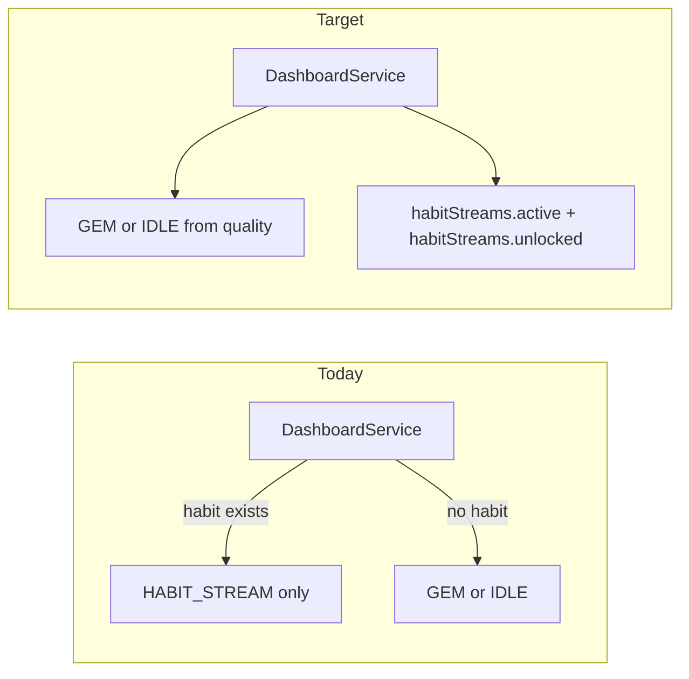

# Multi active habit streams + decoupled gem card

**Overview:** Decouple gem progress from habit-stream UI by removing exclusive `HABIT_STREAM` dashboard state, extending the API to return multiple ACTIVE and NOT_STARTED streams, dropping the DB constraint that enforces one ACTIVE stream per user, and updating the React Native dashboard (and dependents) to render a fixed gem card plus two horizontal rows.

## Implementation checklist

- [ ] Add Supabase migration to drop `unique_active_habit_stream_per_user`; verify inserts allow multiple ACTIVE per user.
- [ ] Refactor DashboardService + HabitStreamService/repository to return GEM/IDLE `currentState` plus `habitStreams: { active, unlocked }`; remove single-stream priority and `createHabitStream` active guard.
- [ ] Update dashboard-models, OpenAPI, HABIT_STREAMS.md; grep and fix other services assuming one active stream.
- [ ] Update DashboardParams model, RTK Query types, SupabaseEdgeFunctions client for new payload.
- [ ] DashboardScreen.view: always MainGemCard for GEM; horizontal FlatLists for active + unlocked; wire Start Habit to bottom sheet by stream id.
- [ ] Dashboard index: per-stream habit logging state, cancel/end selection, optimistic cache updates for arrays; remove HABIT_STREAM-only paths.
- [ ] Catalog / CatalogSeeMore / GemCompletion / Social: remove HABIT_STREAM gating and stale conflict error strings; align with new dashboard data.

---

## Context (current behavior)

- Backend [`project-ihsan-backend/supabase/functions/services/dashboard-service.ts`](../project-ihsan-backend/supabase/functions/services/dashboard-service.ts) **short-circuits**: if `habitStreamService.getHabitStreamState` returns non-null, the dashboard response uses `currentState: { state: 'HABIT_STREAM', habitStream }` and **never** builds GEM state—even when the user still has an active quality/gem path.
- [`project-ihsan-backend/supabase/functions/repositories/habit-stream-progress-repository.ts`](../project-ihsan-backend/supabase/functions/repositories/habit-stream-progress-repository.ts) uses `.maybeSingle()` for “current” stream, which assumes **at most one** row per query.
- [`createHabitStream`](../project-ihsan-backend/supabase/functions/services/habit-stream-service.ts) rejects creation when `hasActiveHabitStream` is true (blocks unlocking a new stream while another is ACTIVE).
- DB migration [`0011_update_habit_stream_status_and_habit_text.sql`](../project-ihsan-backend/supabase/migrations/20251101135412_0011_update_habit_stream_status_and_habit_text.sql) recreates **`unique_active_habit_stream_per_user`**, enforcing **one ACTIVE** row per user at the database level.
- Mobile [`project-ihsan/src/views/screens/DashBoardScreen/DashboardScreen.view.tsx`](../project-ihsan/src/views/screens/DashBoardScreen/DashboardScreen.view.tsx) renders **either** `MainGemCard` **or** habit UI based on `currentState.state === 'HABIT_STREAM'`.
- Mobile [`project-ihsan/src/views/screens/CatalogScreen/index.tsx`](../project-ihsan/src/views/screens/CatalogScreen/index.tsx) blocks starting a new quality when `currentState.state === 'HABIT_STREAM'`; per product direction, this gate goes away with the mode.

---

## 1) Plan: `project-ihsan` (React Native)

### API / types

- Update [`project-ihsan/src/models/DashboardParams.ts`](../project-ihsan/src/models/DashboardParams.ts) (and any mirrored types in views) to match the new backend payload:
  - **`currentState`**: only `GEM | IDLE` (same shape as today for those branches: quality, currentGem, nextGem for GEM). Remove reliance on `state === 'HABIT_STREAM'` and remove `habitStream` from `currentState` **or** keep `habitStream` deprecated unused during a short transition—prefer **removal** once backend ships to avoid split-brain.
  - **`habitStreams`**: new top-level object, e.g. `{ active: HabitStreamData[]; unlocked: UnlockedHabitStreamSummary[] }`.
    - **Active** items: full card payload (same fields `HabitStreamCard` needs: id, text, quality, status, startDate, streak, dailyProgress, references).
    - **Unlocked** items: enough for a compact card + `startHabitStream` call: id, title/text label, quality name, **planned duration** (e.g. day count from `start_date`/`end_date` once set, or a static subtitle from gem metadata—align with whatever the backend returns), `status: NOT_STARTED`.

### Dashboard UI ([`DashboardScreen.view.tsx`](../project-ihsan/src/views/screens/DashBoardScreen/DashboardScreen.view.tsx))

- **Always** render `MainGemCard` when `currentState.state === 'GEM'` (unchanged copy/behavior for Start/Resume gem).
- When `currentState.state === 'IDLE'`, keep existing `QualitiesCarouselCard` behavior; **below** header/stats, render habit sections when arrays are non-empty (so IDLE users can still see streams if the backend returns them).
- Add a **horizontal** `FlatList` (or `ScrollView` + mapped cards) for **active** streams: reuse existing `HabitStreamCard` as the cell component with fixed width (~85–90% screen width) and `snapToInterval` optional—**no visual redesign** beyond layout required for horizontal paging.
- Add a second horizontal list for **unlocked** (`NOT_STARTED`) streams: compact card using **existing** typography/colors/components where possible; primary new control is a **Start Habit** button that triggers the same duration bottom sheet flow but scoped to the **selected** `habit_stream_id`.
- **Remove** the dashboard branch that shows `StartHabitCard` when `state === 'HABIT_STREAM'` (superseded by unlocked-row cards + bottom sheet).

### Dashboard container ([`DashBoardScreen/index.tsx`](../project-ihsan/src/views/screens/DashBoardScreen/index.tsx))

- Replace single-stream assumptions throughout:
  - **`handleHabitAnswer`**: pass `habit_stream_id` from the **card** that fired the action (closure or callback argument), not `currentState.habitStream.id`.
  - **Optimistic updates / completion dialog**: after `logHabitStreamProgress`, refetch and detect completion by comparing **which** stream id left `active` or gained `COMPLETED`—not “`habitStream` is undefined”.
  - **Cancel / finish modals**: today they assume one `dashboardStats.currentState.habitStream.id`. Change to **per-card** actions (overflow menu or long-press) **or** keep global modals but set `selectedHabitStreamId` before open—must support multiple streams.
- **UI state**: replace global `habitAnswered` with a **per-stream** map (e.g. `Record<number, 'yes' | 'no' | null>`) so logging “today” on one card does not blank others; sync from refetch when possible.

### Bottom sheet + start flow

- `handleConfirmHabitStream` (and related optimistic `updateQueryData`): update to push the started stream into **`habitStreams.active`** and remove from **`unlocked`**, and **do not** set `currentState.state` to `HABIT_STREAM`.
- Ensure habit stream bottom sheet receives the **target** stream id from the unlocked card press.

### Other app surfaces (grep-driven audit)

- **Remove** `already has an active habit stream` user-facing errors where the backend no longer returns that conflict: [`GemCompletionScreen/index.tsx`](../project-ihsan/src/views/screens/GemCompletionScreen/index.tsx), [`SocialScreen/hooks.ts`](../project-ihsan/src/views/screens/SocialScreen/hooks.ts).
- **Catalog / CatalogSeeMore**: remove `state === 'HABIT_STREAM'` gating; replace any `currentState.habitStream` reads with `habitStreams.active.length` / `unlocked.length` **only if** you still need product rules—**no HABIT_STREAM mode** implies these checks should disappear or check the new arrays if a softer rule remains.
- **RTK Query** [`supabaseEdgeFunctionsApi.ts`](../project-ihsan/src/store/api/supabaseEdgeFunctionsApi.ts): response typing for `getDashboardParams` follows new `DashboardParams`.
- **Edge function client** [`SupabaseEdgeFunctions.ts`](../project-ihsan/src/services/SupabaseEdgeFunctions.ts): parse/validate new JSON shape if there is explicit parsing.

### Testing focus (app)

- Dashboard: GEM visible + 0, 1, N active cards; unlocked row appears after gem completion creates `NOT_STARTED`.
- Start habit from unlocked row moves card to active row.
- Mark completed today on **each** active card independently.
- Cancel/end one stream does not break others.

---

## 2) Plan: `project-ihsan-backend` (Supabase Edge Functions + DB)

### Database

- **New migration**: `DROP INDEX IF EXISTS unique_active_habit_stream_per_user;`  
  - This is **required** for multiple `ACTIVE` rows per user (index recreated in [`0011_update_habit_stream_status_and_habit_text.sql`](../project-ihsan-backend/supabase/migrations/20251101135412_0011_update_habit_stream_status_and_habit_text.sql)).
- Optional follow-up: if you want to prevent true duplicates (same `gem_id` twice `ACTIVE`), add a **narrower** partial unique index later—only if product requires it.

### Repository layer

- [`habit-stream-progress-repository.ts`](../project-ihsan-backend/supabase/functions/repositories/habit-stream-progress-repository.ts):
  - Replace / supplement `getCurrentHabitStreamForUser` with:
    - `listHabitStreamsForUser(userId, statuses[], orderBy)` returning **arrays** (no `maybeSingle`).
  - Ensure deterministic ordering (e.g. `created_at` or `id`).

### Habit stream service

- [`habit-stream-service.ts`](../project-ihsan-backend/supabase/functions/services/habit-stream-service.ts):
  - **`createHabitStream`**: remove the `hasActiveHabitStream` guard so completing gems can unlock additional `NOT_STARTED` rows even while other streams are `ACTIVE`.
  - **Split “dashboard habit payload”** from “single current stream”:
    - Add e.g. `buildHabitStreamsForDashboard(userId, timezone) => { active: HabitStreamInfo[], unlocked: … }` by:
      - Listing all `ACTIVE` streams → for each, reuse existing `_buildDailyProgress` / `_calculateStreak` logic (extract “build full card from `CurrentHabitStreamWithDetails`” into a private helper to avoid duplication).
      - Listing all `NOT_STARTED` streams → minimal objects (id, text, quality, status; add optional fields for subtitle like duration if stored on row or derivable).
  - Deprecate or narrow `getHabitStreamState` once dashboard no longer uses the old shape.

### Dashboard service

- [`dashboard-service.ts`](../project-ihsan-backend/supabase/functions/services/dashboard-service.ts):
  - **Always** compute `userStats` as today.
  - **Always** compute `currentState` from quality progress only (`GEM` or `IDLE`)—**remove** the early return that prefers habit stream over gem.
  - **Always** attach `habitStreams: { active, unlocked }` from the new habit-stream builder (empty arrays when none).

### Models + API contract

- [`dashboard-models.ts`](../project-ihsan-backend/supabase/functions/shared/models/dashboard-models.ts): extend `DashboardParams` with `habitStreams`; update `DashboardCurrentState` union to drop `HabitStreamCurrentState` **or** keep type in file unused until OpenAPI/clients updated (prefer clean removal in same release).
- [`content-management/index.ts`](../project-ihsan-backend/supabase/functions/content-management/index.ts) path for `get-dashboard-params`: no route change expected; response schema changes.
- Update [`openapi.yaml`](../project-ihsan-backend/openapi.yaml) / [`openapi_updated.yaml`](../project-ihsan-backend/openapi_updated.yaml) and internal docs [`HABIT_STREAMS.md`](../project-ihsan-backend/documentations/architecture/HABIT_STREAMS.md).

### Other callers of `getCurrentHabitStreamForUser` / `getHabitStreamState`

- Grep the backend for `getHabitStreamState`, `getCurrentHabitStreamForUser`, `hasActiveHabitStream`, and `HABIT_STREAM` string; update any accountability-partner or notification logic that assumed a single active stream.

### Testing focus (backend)

- SQL: two `ACTIVE` rows for one `user_id` insert succeeds after index drop.
- `getDashboardParams` returns `currentState.state === 'GEM'` and `habitStreams.active.length > 1` when applicable.
- `createHabitStream` succeeds with an existing other `ACTIVE` stream.

---

## Coordination / rollout

- Deploy **migration first** (or same release as app), then edge functions, then mobile—otherwise inserts may violate the unique index or the app may parse missing `habitStreams`.
- Product note: streams are not removed from the “master” habit list when closed; the plan keeps **completed** rows in `habit_streams` as today and only returns `ACTIVE` + `NOT_STARTED` in the two dashboard lists unless you later add a “history” row.
