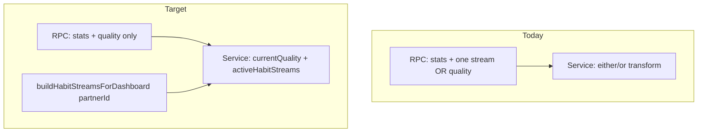

# Accountability partner details: quality + multiple active habit streams

**Deliverable file:** [plans/partner_details_multi_streams_852f2167.md](plans/partner_details_multi_streams_852f2167.md)

---

## Problem (current behavior)

The partner-details path enforces **mutual exclusion**:

```819:837:project-ihsan-backend/supabase/functions/services/accountability-partners-service.ts
      // Priority: If user has habit stream, show that instead of quality
      let currentQuality = null;
      let currentHabitStream = null;

      if (details.current_habit_stream_quality_name && details.current_habit_stream_habit_text) {
        currentHabitStream = { ... };
      } else if (details.current_quality_name) {
        currentQuality = { ... };
      }
```

The RPC [`get_accountability_partner_details`](project-ihsan-backend/supabase/migrations/20251214003400_optimized_partner_details_with_timezone.sql) also:

- Nullifies `current_quality_*` when **any** habit stream row exists (`CASE WHEN hs.id IS NULL`)
- Joins `habit_streams` with `status IN ('ACTIVE', 'NOT_STARTED')` **without** `LIMIT 1` — unsafe with multiple streams (ambiguous `SELECT INTO`)
- Builds daily progress for **one** stream only

The dashboard already does the target model in [`dashboard-service.ts`](project-ihsan-backend/supabase/functions/services/dashboard-service.ts): `currentState` (GEM/IDLE from quality) **plus** `habitStreams.active` from [`buildHabitStreamsForDashboard`](project-ihsan-backend/supabase/functions/services/habit-stream-service.ts).

**Product scope (confirmed):** ACTIVE habit streams only — no `NOT_STARTED` / unlocked row on partner details.

---

## Target behavior

| Field | When present |
|--------|----------------|
| `currentQuality` | Partner has `user_quality_progress.status = 'IN_PROGRESS'` |
| `activeHabitStreams` | Partner has one or more `habit_streams.status = 'ACTIVE'` (full card payload + `dailyProgress`) |
| Both null/empty | Valid — "no active journey" empty state in UI |



---

## 1) Backend

### 1a) New SQL migration

Add e.g. `supabase/migrations/20260520000000_0030_partner_details_decouple_quality.sql`:

- **Remove** `habit_streams` join and all habit-stream columns from `get_accountability_partner_details` return type and body (Steps 2 progress loop deleted).
- **Always** compute `current_quality_name` / `current_quality_completion_percentage` from `user_quality_progress` + gems (no `hs.id IS NULL` guards).
- Keep: partnership check, profile stats (`total_*`, `last_gem_completed_at`, `total_habit_days_completed`), `connected_since`, `p_timezone`.

This fixes multi-stream row ambiguity and shrinks the RPC to what it does well (profile + quality %).

### 1b) Repository types

[`accountability-partners-repository.ts`](project-ihsan-backend/supabase/functions/repositories/accountability-partners-repository.ts) — trim `PartnerDetailsFromRPC` to drop `current_habit_stream_*` fields.

### 1c) Service composition (core change)

[`accountability-partners-service.ts`](project-ihsan-backend/supabase/functions/services/accountability-partners-service.ts):

- Inject `IHabitStreamService` in constructor.
- Update `PartnerDetails` interface:
  - Keep `currentQuality: { name, completionPercentage } | null`
  - Replace `currentHabitStream` with `activeHabitStreams: ActiveHabitStreamInfo[]` (import from [`habit-stream-service.ts`](project-ihsan-backend/supabase/functions/services/habit-stream-service.ts) or shared model)
- In `getAccountabilityPartnerDetails`:
  1. RPC → stats + `currentQuality`
  2. `const { active } = await habitStreamService.buildHabitStreamsForDashboard(partnerId, timezone)`
  3. Return `activeHabitStreams: active` (ACTIVE-only; ignore `unlocked`)

Remove either/or transform block (lines 819–837).

### 1d) DI wiring

[`di-container.ts`](project-ihsan-backend/supabase/functions/shared/di-container.ts):

- Instantiate `habitStreamService` **before** `accountabilityPartnersService`.
- Pass `habitStreamService` into `AccountabilityPartnersService` (no circular dependency: habit stream service does not depend on accountability partners).

### 1e) API contract

Update [`openapi.yaml`](project-ihsan-backend/openapi.yaml) (and [`openapi_updated.yaml`](project-ihsan-backend/openapi_updated.yaml) if kept in sync):

- Endpoint description: remove "habit streams take priority over quality".
- `GetAccountabilityPartnerDetailsResponse`:
  - `currentQuality`: nullable; **not** suppressed when habits exist
  - Replace `currentHabitStream` with `activeHabitStreams` (array of objects aligned with dashboard `ActiveHabitStreamInfo`: `id`, `text`, `quality`, `status`, `startDate`, `streak`, `dailyProgress`)
- Update examples (quality + multiple streams, quality-only, streams-only, neither).

---

## 2) Mobile app (Frontend)

### 2a) Types — [`AccountabilityPartnerModels.ts`](project-ihsan/src/models/AccountabilityPartnerModels.ts)

**Goal:** Add the new `activeHabitStreams` field while keeping `currentHabitStream` for backward compatibility during rollout.

```typescript
// Import or mirror ActiveHabitStreamInfo from DashboardParams
import { ActiveHabitStreamInfo } from './DashboardParams';

export interface GetAccountabilityPartnerDetailsResponse {
  displayName: string;
  connectedSince: string;
  totalQualitiesCompleted: number;
  totalGemsCompleted: number;
  totalHabitDaysCompleted: number;
  currentQuality: CurrentQualityDetails | null;
  /** @deprecated Use activeHabitStreams instead. Will be removed in a future version. */
  currentHabitStream: CurrentHabitStreamDetails | null;
  /** New: array of active habit streams (ACTIVE status only) */
  activeHabitStreams?: ActiveHabitStreamInfo[];
  lastGemCompletedAt: string | null;
  message: string;
}
```

**Key decisions:**
- `activeHabitStreams` is **optional** (`?`) so the UI doesn't break if the backend hasn't been deployed yet.
- `currentHabitStream` is kept but marked `@deprecated` for backward compatibility.

### 2b) UI — [`PartnerDetailCard.tsx`](project-ihsan/src/views/components/PartnerDetailCard.tsx)

**Goal:** Handle the new `activeHabitStreams` response without breaking the UI. No new UI components are added. Additional habit streams beyond the first can be safely ignored (not shown).

**Current rendering logic (lines 355–457):**
1. `partnerDetails?.currentHabitStream` → renders habit stream section
2. `partnerDetails?.currentQuality` → renders quality progress bar
3. Fallback → "No active quality" empty state

**Updated rendering logic:**

```
if (partnerDetails?.activeHabitStreams && partnerDetails.activeHabitStreams.length > 0) {
  // Use the FIRST active habit stream (ignore extras — safe to not show them)
  const firstStream = partnerDetails.activeHabitStreams[0];
  renderHabitStreamSection(firstStream);
} else if (partnerDetails?.currentHabitStream) {
  // Backward compat: fall back to old field if activeHabitStreams is empty/missing
  renderHabitStreamSectionFromLegacy(partnerDetails.currentHabitStream);
} else if (partnerDetails?.currentQuality) {
  renderQualitySection(partnerDetails.currentQuality);
} else {
  renderEmptyState();
}
```

**Detailed changes:**

1. **Habit stream section (lines 355–414):**
   - Add a check for `activeHabitStreams` **before** the existing `currentHabitStream` check.
   - If `activeHabitStreams.length > 0`, take the **first** stream and map its fields to the existing UI:
     - `firstStream.quality` → replaces `partnerDetails.currentHabitStream.qualityName`
     - `firstStream.text` → replaces `partnerDetails.currentHabitStream.habitText`
     - `firstStream.dailyProgress` → replaces `partnerDetails.currentHabitStream.dailyProgress` (same shape)
   - **Do not render additional streams** — it is acceptable to ignore them. The UI will not break.

2. **Quality section (lines 415–447):**
   - No changes needed. The quality block already renders when `currentQuality` is present.
   - With the new backend, `currentQuality` will no longer be suppressed when habit streams exist, so both quality and habit stream sections can appear together.

3. **Empty state (lines 448–456):**
   - Update the condition: show empty state only when `!currentQuality && (!activeHabitStreams || activeHabitStreams.length === 0) && !currentHabitStream`.
   - Update copy to be neutral: "No active journey at the moment" instead of "No active quality".

4. **Celebration section (lines 300–329):**
   - Uses `partner.currentHabitStreak` from the local `Partner` interface — no changes needed. This is separate from the API response.

**No new UI components are introduced.** The existing habit stream week-tracker markup (lines 367–413) is reused as-is.

### 2c) Field mapping summary

| Existing UI field | New source (`ActiveHabitStreamInfo`) |
|-------------------|--------------------------------------|
| `qualityName` | `activeHabitStreams[0].quality` |
| `habitText` | `activeHabitStreams[0].text` |
| `dailyProgress` | `activeHabitStreams[0].dailyProgress` (identical shape) |

### 2d) Grep cleanup

Search `currentHabitStream` in `project-ihsan` and backend tests/docs; update Social screen / any mocks. Mark usages as deprecated but do not remove until backend rollout is confirmed.

Files to check:
- [`project-ihsan/src/views/components/PartnerDetailCard.tsx`](project-ihsan/src/views/components/PartnerDetailCard.tsx)
- [`project-ihsan/src/views/screens/SocialScreen/types.ts`](project-ihsan/src/views/screens/SocialScreen/types.ts)
- [`project-ihsan/src/store/api/supabaseEdgeFunctionsApi.ts`](project-ihsan/src/store/api/supabaseEdgeFunctionsApi.ts)
- [`project-ihsan/src/services/SupabaseEdgeFunctions.ts`](project-ihsan/src/services/SupabaseEdgeFunctions.ts)

---

## 3) Testing

| Layer | Cases |
|--------|--------|
| SQL/RPC | Partner with IN_PROGRESS quality only; ACTIVE stream(s) only; both; neither; two ACTIVE streams → RPC returns quality, no duplicate-row error |
| Service | `activeHabitStreams.length === 2` when partner has 2 ACTIVE; `currentQuality` populated alongside streams |
| App — types | `GetAccountabilityPartnerDetailsResponse` accepts `activeHabitStreams` array; `currentHabitStream` still works for backward compat |
| App — UI | Partner card shows quality + first habit stream; extra streams are silently ignored; empty state when both absent; no UI breakage when `activeHabitStreams` is missing from response |

Manual: Social tab → select connected partner with gem path + active habits.

---

## 4) Rollout notes

- **Breaking API change** (`currentHabitStream` → `activeHabitStreams`). Ship backend + app together.
- Frontend maintains backward compatibility by checking `activeHabitStreams` first, falling back to `currentHabitStream`.
- Reuse `buildHabitStreamsForDashboard` so daily progress / timezone logic stays identical to dashboard (see [plans/multi-habit-streams-dashboard.md](plans/multi-habit-streams-dashboard.md)).
- Do **not** include `habitStreams.unlocked` on partner details (per scope).
- **UI constraint:** Only the first active habit stream is displayed. Additional streams are safely ignored — this is intentional and does not break the UI.

---

## Files to touch (summary)

| Area | Files |
|------|--------|
| DB | New migration under `project-ihsan-backend/supabase/migrations/` |
| Backend | `accountability-partners-service.ts`, `accountability-partners-repository.ts`, `di-container.ts`, `openapi.yaml` |
| App — types | `AccountabilityPartnerModels.ts` |
| App — UI | `PartnerDetailCard.tsx` |
| Docs | `plans/partner_details_multi_streams_852f2167.md` |
