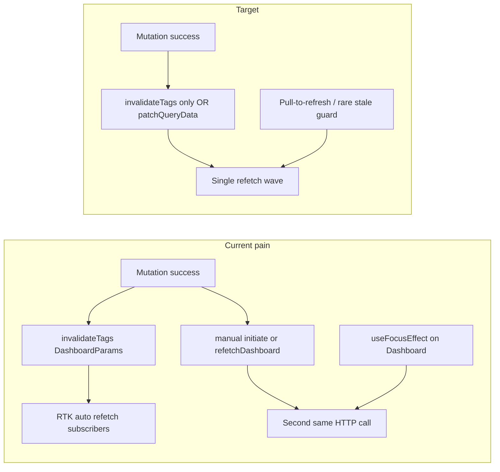

# RTK Query and UI streamlining (project-ihsan)

**Status:** planning  
**Goal:** Remove duplicate Supabase requests and glitchy full-view reloads by streamlining RTK Query usage and stabilizing UI during background refetch.

**Product decisions (locked for this plan):**

- **Freshness:** Rely on **mutation invalidation** and **pull-to-refresh**; do **not** keep unconditional refetch-on-focus for `getDashboardParams` (session recovery stays on `baseQueryWithReauth` in the API slice).
- **Dialogs:** Background **may** refetch while a dialog is open; prioritize **no full-screen flash** (skeleton swaps, heavy remounts)—not blocking network entirely.

---

## Context (what is going wrong today)

- **Stacked refetches:** Flows call `dispatch(invalidateTags([DashboardParams]))` then `getDashboardParams.initiate(..., { forceRefetch: true })` or `refetchDashboard()`. Mutations in `project-ihsan/src/store/api/supabaseEdgeFunctionsApi.ts` already set `invalidatesTags` for `DashboardParams` (e.g. `logHabitStreamProgress`, `endHabitStream`, `startQuality`, `startGem`, `endGem`, habit stream mutations). One user action often triggers **two or more identical** `getDashboardParams` calls.
- **Focus refetch:** `project-ihsan/src/views/screens/DashBoardScreen/index.tsx` uses `useFocusEffect` to always `refetchDashboard()`. Combined with invalidation when returning from Gem or completion flows, the dashboard refetches again on **every** focus.
- **Gem completion triple-write:** `project-ihsan/src/views/screens/GemCompletionScreen/index.tsx` runs `updateQueryData`, then `invalidateTags`, then forced prefetch for the same `getDashboardParams` key.
- **Gem screen:** `project-ihsan/src/views/screens/GemScreen/index.tsx` uses `useGetGemQuery` and `useGetDashboardParamsQuery`. `postUserResponses` invalidates `DashboardParams` (and `Qualities`), so **each in-gem save** can refetch the full dashboard.
- **Social (accountability):** `project-ihsan/src/views/screens/SocialScreen/index.tsx` runs three `useGetAccountabilityPartnersQuery` hooks (fine for cache keys), but pull-to-refresh and invite success use **`invalidateTags` plus `Promise.all([refetchConnected, refetchSent, refetchReceived])`**, duplicating refetches. The partner merge effect **waits until all three queries are not fetching**, which blocks or empties the list during staggered refetches.

---

## 1. Dashboard — single refetch wave, stable UI

**API defaults** (`supabaseEdgeFunctionsApi.ts` → `getDashboardParams`):

- Set `refetchOnFocus: false` (and `refetchOnReconnect` per product policy) so navigation focus does not stack on invalidation.
- Optionally set `keepUnusedDataFor` so tab switches reuse cache unless invalidated.

**Container** (`DashBoardScreen/index.tsx`):

- Remove the `useFocusEffect` that only calls `refetchDashboard()`.
- Keep **pull-to-refresh** (`handleManualRefresh`) as the explicit refresh path.
- After mutations that already invalidate `DashboardParams`, remove paired `invalidateTags` + `initiate(forceRefetch)` unless a single explicit refetch is truly required for control flow.
- `handleStartBuilding`: `startQuality` already invalidates dashboard — remove redundant `await refetchDashboard()` or replace with **one** awaited `getDashboardParams.initiate` if you must block on fresh state.

**Qualities (`skip: !isIdle`):**

- Mitigate `isIdle` flicker during refetch (hysteresis, settled idle, or `selectFromResult`) so the carousel does not mount/unmount repeatedly.

**View** (`DashboardScreen.view.tsx`):

- Do not treat `isFetching` as full-screen loading when `dashboardStats` exists; audit notifications and habit sections similarly.
- Memoize heavy subtrees (`React.memo` or split components) so dialog-open periods do not replay expensive renders.

---

## 2. Dialogs — stable background during operations

- Tie dialog UI to **local mutation submitting state**, not global `isFetching` from unrelated queries.
- Consider `Modal` / stable dialog root; memoize list/cards behind the overlay.
- Avoid `invalidateTags` + `initiate` in the same handler as dialog open unless necessary; priority is **no layout swap / no skeleton flash** when background refetch runs.

---

## 3. Gem screen (in-session)

- Prefer **read-only cache reads** for dashboard fields (`useSelector` + `supabaseEdgeFunctionsApi.endpoints.getDashboardParams.select(userTimezone)`) or **navigation params** from Dashboard so Gem does not subscribe to unnecessary refetch churn.
- **`postUserResponses`:** Consider **narrower** `invalidatesTags` during the sprint (e.g. `Gem` / `GemStatus` only) and invalidate `DashboardParams` **once** on gem complete/exit, if backend consistency allows.
- **Exit:** Keep a **single** `DashboardParams` invalidation (or one refetch) when leaving Gem so home data is fresh without focus refetch.

---

## 4. Gem completion screen

After `createHabitStream` succeeds, use **one** path:

- **Preferred:** `updateQueryData` only from the mutation payload; drop manual `invalidateTags` + forced prefetch for this path, **or**
- **Alternative:** `invalidateTags` only and let RTK refetch once (remove extra prefetch).

Align with `createHabitStream`’s own `invalidatesTags`; avoid duplicating the same invalidation in the screen unless `onQueryStarted` in the slice is the better home for a cache patch.

---

## 5. Accountability partner (Social screen)

- Remove `Promise.all([refetchConnected, ...])` where it duplicates invalidation-driven refetch; rely on mutation + tags or a single `invalidateTags` without manual refetches.
- Merge partner lists from **partial** query data; do not block the merge on all three queries finishing `isFetching`.
- **Optional:** Remove `DashboardParams` from `inviteAccountabilityPartner.invalidatesTags` if no global UI requires it from Social.
- Gate or remove verbose `console.log(JSON.stringify(...))` in the Social container to reduce JS thread work.

---

## 6. Cross-cutting conventions

- **Rule:** Per user flow, choose **at most one** of `{ invalidatesTags, updateQueryData, manual refetch/initiate }` unless documented otherwise.
- Use RTK Query DevTools or short-lived logging in dev to verify duplicate `getDashboardParams` / partner calls before vs after.
- Optional: tests with mocked network asserting a single refetch for a given mutation + navigation path.

---

## Primary files

| Area | Path |
|------|------|
| API defaults / tags | `project-ihsan/src/store/api/supabaseEdgeFunctionsApi.ts` |
| Dashboard container | `project-ihsan/src/views/screens/DashBoardScreen/index.tsx` |
| Dashboard view | `project-ihsan/src/views/screens/DashBoardScreen/DashboardScreen.view.tsx` |
| Gem | `project-ihsan/src/views/screens/GemScreen/index.tsx` |
| Gem completion | `project-ihsan/src/views/screens/GemCompletionScreen/index.tsx` |
| Accountability | `project-ihsan/src/views/screens/SocialScreen/index.tsx` |
| Other callers to audit | `project-ihsan/src/views/screens/CatalogScreen/index.tsx`, `CatalogSeeMoreScreen/index.tsx` |

---

## Implementation checklist

- [ ] `getDashboardParams`: `refetchOnFocus: false`, optional `keepUnusedDataFor`
- [ ] Remove dashboard `useFocusEffect` refetch; keep pull-to-refresh
- [ ] Remove invalidate + `initiate(forceRefetch)` stacks where mutation already invalidates
- [ ] Stabilize qualities fetch when `isIdle` toggles
- [ ] Dashboard view: no full-shell loader on background `isFetching` when data exists; memoize heavy sections
- [ ] Gem: decouple dashboard query / narrow `postUserResponses` invalidation
- [ ] Gem completion: single cache update strategy
- [ ] Social: no invalidate + triple manual refetch; merge on partial data
- [ ] Document this file’s rule of thumb in PR / team channel when implementing

---

## Reference

This document is the canonical plan in-repo. A Cursor-generated plan may exist under `.cursor/plans/` for session history; treat **this file** as the source of truth for scope and decisions.
