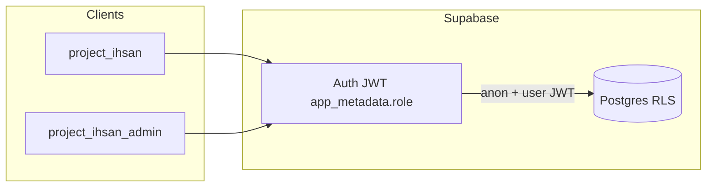

# Role-based access with Supabase (Master Admin, Admin, User)

## Current architecture (baseline)

- **Database**: Tables like [`qualities`](project-ihsan-backend/supabase/migrations/20250912234454_0001_initial_migration.sql) and `gems` use RLS with **default deny** for authenticated users and **full access for `service_role` only** for writes to content tables.
- **project-ihsan-admin**: Repositories use [`ClientFactory.createServiceClient()`](project-ihsan-admin/lib/services/supabase/core/client-factory.ts), so **admin DB operations bypass RLS** and are not tied to the logged-in user’s JWT.
- **Target**: **Option A** — use the **authenticated user’s JWT** for content mutations and **enforce roles in Postgres RLS** so bypassing the UI does not bypass security.

---

## 1. Role model and storage in Supabase

**Recommended**: Store the canonical role in **`auth.users.raw_app_meta_data`** (e.g. `role` or `app_role`) via **Admin API / SQL**, not in client-editable `user_metadata`.

- **String values**: `master_admin`, `admin`, `user`.
- **Default for new signups**: `user`.
- **Promotion / demotion**: Dashboard, SQL, or a secured Edge Function using **service role** — never from the mobile client.

**Strongly recommended for Option A**: **Custom Access Token Hook** (or equivalent) so every refreshed JWT includes the current `role` claim used in RLS. Alternatively, document that **metadata updates require re-login or session refresh**.

---

## 2. Enforcement matrix (product rules)

### Portal access

| Role | project-ihsan (mobile) | project-ihsan-admin |
|------|------------------------|---------------------|
| **user** | Normal app usage | **No access** (middleware + optional `/unauthorized`) |
| **admin** | Normal app usage | **Yes**, with restrictions below |
| **master_admin** | Normal app usage | **Full** administrative capabilities |

### Admin vs Master Admin (content)

**Master Admin** may perform **all** operations currently supported by the admin app (including publish, unpublish, delete qualities, delete gems, and any related workflows).

**Admin** — explicit denials:

- **Cannot delete** a **quality**.
- **Cannot delete** a **gem**.
- **Cannot publish** a quality or gem (including create paths that would set `PUBLISHED`, or updates that change state to `PUBLISHED`).
- **Cannot unpublish** a quality or gem (transitions from `PUBLISHED` to `DRAFT` / non-published).

All of the above must be enforced in **RLS** (Option A) and reflected in the **UI** (hide/disable the corresponding controls for `admin`).

**Admin — allowed behavior (confirmed)**:

- **Create and edit** qualities and gems in **DRAFT** (including nested content such as exercises, flow rules, prerequisites as supported by the app today), **except** any action that would **publish**, **unpublish**, or **delete** the parent quality or gem.
- **Edit existing PUBLISHED** qualities and gems **in place** (copy, assets, structure under the hood) as long as **`state` does not change** — no publish/unpublish and no delete of the quality or gem row.
- **Creators’ delete**: An **Admin** who created a quality still **cannot delete** that quality (same as any quality).

**No extra “permission levels”** beyond `master_admin` / `admin` / `user`: there is **no separate RBAC layer** for the **Levels** feature or other areas unless a future requirement adds one. For now, only the **quality / gem** lifecycle rules above are restricted for **Admin**; other admin features keep current behavior unless they conflict with RLS design (e.g. if deleting a level cascades to content, align policies with product intent).

---

## 3. project-ihsan-admin: portal gate (User vs Admin/Master Admin)

- **Middleware** ([`middleware.ts`](project-ihsan-admin/lib/services/supabase/middleware.ts)): After validating session, read `role` from JWT / `user.app_metadata`. If `user`, block protected routes (`/dashboard`, `/qualities`, `/gems`, `/levels`).
- **Auth context**: Expose `role` and helpers (`isMasterAdmin`, `isAdmin`) for UI and messaging.
- **Defense in depth**: Even with RLS, middleware avoids confusing UX for plain **user** accounts.

---

## 4. Option A — Postgres RLS (primary enforcement)

### Principles

- **Content mutations** from the admin app use [`createServerClient`](project-ihsan-admin/lib/services/supabase/core/client-factory.ts) (or equivalent) with the **requesting user’s JWT**, **not** the service role client.
- **Policies** use a helper like `(auth.jwt() -> 'app_metadata' ->> 'role')` (exact path must match how claims are namespaced in your project—verify in Supabase JWT payload) or `current_setting('request.jwt.claims', true)::json` depending on your Supabase/Postgres version patterns.

### Suggested policy shape (illustrative)

- **`master_admin`**: Full `INSERT`/`UPDATE`/`DELETE` on `qualities`, `gems`, and related tables as today (subject to FK integrity).
- **`admin`**:
  - **DELETE** on `qualities` / `gems`: **deny** (no policy allowing delete, or explicit restrictive policy).
  - **INSERT**: allow **only** when `state` is **not** `PUBLISHED` (draft creates only), unless you intentionally allow creating unpublished rows only.
  - **UPDATE**: allow **admin** to change **non-state** columns on **both** `DRAFT` and `PUBLISHED` rows; **deny** any **UPDATE** that would set `state` to `PUBLISHED`, or change `state` from `PUBLISHED` to `DRAFT` (use **WITH CHECK** comparing `OLD`/`NEW` via trigger, or split policies). PostgreSQL RLS alone cannot read `OLD` row in plain `WITH CHECK` in all versions — often a **`BEFORE UPDATE` trigger** on `qualities` / `gems` raising `check_violation` when **admin** attempts a forbidden **state** transition is clearer than policy-only.
- **`user`**: No admin writes on these tables (no policy → default deny remains).

### Scope of migration

- Identify **all tables** touched by admin server actions today (qualities, gems, exercises, flow rules, prerequisites, levels, storage metadata, etc.). Apply **role-aware** rules so **Admin** cannot circumvent quality/gem rules via side paths (e.g. policies on child tables where deletes would effectively destroy published content — align with product: gem/quality row delete is banned; exercise edits may still be allowed per current app behavior).

### Service role

- **Remove** service client from default admin repository constructors for user-driven flows.
- **Keep** service role only for **backend-only** jobs (seed, cron, edge functions internal, bootstrap) — not for normal admin UI requests.

---

## 5. project-ihsan-admin: server actions and UI

- **Server actions** ([`qualities/actions.ts`](project-ihsan-admin/app/(admin-panel)/qualities/actions.ts), [`gems/actions.ts`](project-ihsan-admin/app/(admin-panel)/qualities/[qualityId]/gems/actions.ts), etc.) should call repositories backed by the **user** client. RLS returns errors on violation; optionally **pre-check role** for clearer error messages.
- **UI**: For `admin`, hide **Delete**, **Publish**, **Unpublish**, and **delete gem** entry points; **Master Admin** sees everything.

---

## 6. project-ihsan (mobile)

- No login change: all roles share the same Supabase Auth.
- **user** and **admin** and **master_admin** all use the mobile app the same way unless you later add product-specific UX.

---

## 7. Edge functions (follow-up, not Option A core)

Edge functions that mutate data or accept `userId` from the client should **validate Bearer JWT** and match `sub` to `userId` — separate hardening track from RLS for admin content.

---

## 8. Operational checklist

- Bootstrap **first `master_admin`** (one-time SQL / Dashboard).
- Runbook: promoting users, role changes, JWT refresh behavior with Custom Access Token Hook.
- Tests: RLS behavior can be tested with SQL as different roles or integration tests against Supabase.

---

## 9. Resolved decisions log

- **Defense in depth strategy**: **Option A** (RLS + authenticated client for admin content writes); not Edge Function gateway as primary.
- **Admin restrictions**: No delete quality, no delete gem, no publish, no unpublish (qualities and gems). Master Admin unrestricted.
- **Admin allowed**: Draft create/edit as today (minus lifecycle actions above); **in-place edit** of **published** rows **without** changing `state`.
- **RBAC scope**: Only the three roles — **no separate “levels” permission model**; quality/gem rules are the explicit Admin limits unless you add more later.
